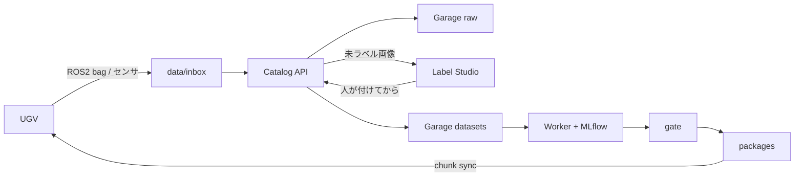

# 防衛用UGV — オンプレ OSS MLOps

帰還データと物理媒体を前提に、**データセット構築 → 学習 → 評価ゲート／署名 → 車載への差分配送** を、インターネット無しで回すための環境です。既存の UAIS 学習DB（層3）と、多段階学習（S0〜S4）に合わせています。

一連の流れ（四脚 PJ の Git / MLflow / DVC / MinIO / Mender との対応）は [docs/workflow.md](docs/workflow.md)。**アノテーションは必須**（Label Studio / SALT / Xtreme1 / SAM）[docs/annotation.md](docs/annotation.md)。手順の本体は [docs/usage.md](docs/usage.md)。**新しい Windows PC への構築**は [docs/setup-windows.md](docs/setup-windows.md)。**構造・データフロー・ツール連携**は [docs/design.md](docs/design.md)。閉鎖網への搬入は [docs/airgap.md](docs/airgap.md)。

## 完全にオフラインか

**学習・保管・署名の閉ループはオフラインです。** クラウド MLOps も外部 API も使いません。データは Garage と PostgreSQL に留まります。

ただし:

1. **最初の 1 回**（または別マシンへの展開）だけ、Docker イメージ取得にネットが要ります。
2. このホストではイメージ済みなので、LAN を切っても `docker compose up -d` で再起動できます。
3. 別の閉鎖区画へは `.\scripts\airgap-export.ps1` → 物理媒体 → `.\scripts\airgap-import.ps1`。
4. 閉鎖側では `docker compose pull` と `--build` を使わないこと（Hub / PyPI に出ます）。

## 構成（OSS）

既定は **bag 取込 → パース → アノテーション → データセット → 学習結果** の中核だけ。拡張は `docker compose --profile full up -d`。

| 役割 | ソフトウェア | ポート | 起動 |
|------|----------------|--------|------|
| ポータル | nginx | 8080 | 既定 |
| カタログ／ジョブ API | FastAPI（本リポジトリ） | 8000 | 既定 |
| 学習ワーカー | 同上 | — | 既定 |
| オブジェクトストレージ | Garage（S3 互換） | 9000 / 3903 | 既定 |
| 実験追跡・モデル成果物 | MLflow | 5000 | 既定 |
| アノテーション | Label Studio | 8081 | 既定 |
| メタデータ | PostgreSQL 16 | 5432 | 既定 |
| データ版管理（Git 風） | LakeFS | 8001 | `--profile full` |
| Git | Gitea | 3000 | `--profile full` |
| 監視 | Prometheus / Grafana | 9090 / 3001 | `--profile full` |

学習段と許容成果物は `configs/artifact_policy.yaml` で固定します。S1（車載）はアダプタ／較正のみ、S3（前線）と S4（後方）でフル重みを許可します。

四脚 PJ と同じ層に加え、自動運転では **人手アノテーションが必須**（シミュは教師を自動生成するが、帰還 bag はしない）。DVC / MinIO / Mender は足さない。



## 起動（この PC）

デスクトップの `起動スクリプト\MLOPS\MLOPS起動.bat`、または:

```powershell
C:\Users\xeno1\MLOPS\launcher\MLOPS_run.bat
```

メニュー 1 が中核スタック、2 がポータルです。コマンドだけなら:

```powershell
cd C:\Users\xeno1\MLOPS
docker compose up -d
```

ポータル: http://127.0.0.1:8080（ダッシュボード / 8工程 / 課題）

各ツールの初期 ID / パスワードは [docs/usage.md](docs/usage.md#画面の場所と初期-id--パスワード) です。

デモ（知覚分類 / E2E / YOLOX / 公開 rosbag2）:

```powershell
Invoke-RestMethod -Method POST http://localhost:8000/demo
Invoke-RestMethod -Method POST http://localhost:8000/demo-e2e
Invoke-RestMethod -Method POST http://localhost:8000/demo-yolox
Invoke-RestMethod -Method POST http://localhost:8000/demo-rosbag
Invoke-RestMethod http://localhost:8000/status
```

ROS2 bag・他センサ・E2E のフォルダ契約は [docs/dataset.md](docs/dataset.md)、日常手順は [docs/usage.md](docs/usage.md) です。

## セキュリティ上の注意

- `.env` の初期パスワードはデモ用です。本番・機密区画では必ず変更してください。
- 学習用生データの外部送信は想定していません。
- 本番適用はゲート（指標・署名・任務モード）を通過したパッケージのみです。
- 本環境は知覚・走行判断モデルの学習運用向けです。火力統制とは分離してください。
