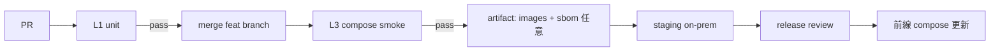

# CI/CD とテスト自動化設計

オンプレ UGV MLOps 向け。クラウド SaaS 前提にせず、**ゲート付きの自動検証**と**人手確認が残る工程**を分離する。関連: [pipeline-stages.md](pipeline-stages.md)、[tasks.md](tasks.md)、[carla.md](carla.md)、[design.md](design.md)。

---

## 1. 目標

| 目標 | 意味 |
|------|------|
| 早く壊す | 契約違反（gate / sync / path allowlist / ack）を PR 段階で落とす |
| 再現可能 | 同じコマンドが開発 PC・CI・閉鎖網のミラーで動く |
| 高価なものは稀に | GPU / CARLA / 実 bag は nightly または手動ゲート |
| 配備前の真実 | staging 相当の compose smoke を CD の必須ゲートにする |

**やらない:** CI で CarlaUE4 を常時起動する、本番 Garage へ自動 promote、署名鍵を CI ログに出す。

---

## 2. テストピラミッド（本リポジトリ）

```text
          ┌─────────────────────┐
          │ E2E / 手動デモ      │  ポータル 11工程・実車 sync
          │ (稀・人手 / nightly)│
          └─────────┬───────────┘
                    │
          ┌─────────▼───────────┐
          │ Integration         │  compose + pytest API/job
          │ (PR optional / CD)  │  Postgres/Garage 実サービス
          └─────────┬───────────┘
                    │
          ┌─────────▼───────────┐
          │ Contract / Unit     │  純関数・パス・gate・carla_launch dry-run
          │ (全 PR 必須)        │  DB はスタブ可
          └─────────────────────┘
```

| 層 | 置き場 | 何を守るか | 所要目安 |
|----|--------|------------|----------|
| L0 lint/type | ruff /（任意）mypy | 文法・import | &lt; 1 min |
| L1 unit | `tests/test_*.py` | bridge / launch dry-run / pipeline_qa / gate 規則 | &lt; 2 min |
| L2 contract | 同 + OpenAPI スナップショット任意 | API スキーマ・job kind・runner 割当 | &lt; 3 min |
| L3 compose smoke | `scripts/ci-smoke.*`（今後） | catalog health、demo ingest、1 train stub | 5–15 min |
| L4 GPU host | 手動 / self-hosted | AutoE2E 1 epoch、YOLOX 短学習 | 可変 |
| L5 CARLA | 手動 / 専用 runner | launch→bag→import→ingest | 人手寄り |
| L6 vehicle sync | ステージング UGV | package_sync + sha256 | リリース前 |

---

## 3. パイプライン工程 × 自動化可否

| 工程 | 自動テスト | 備考 |
|------|------------|------|
| 1 sim_generate | unit: ack は mission+bag 必須；launch dry-run；import allowlist | 実 CARLA は L5 |
| 2 collect | inbox 一覧 API の契約 | |
| 3 ingest | fixture bag/画像 → mission 行 | L3 で本線 |
| 4 data_qa | 不足コンテンツで fail | |
| 5–6 annotate / review | I/O パス・監査ログ（ツール UI は人手） | LS/Xtreme1 は L3 health |
| 7 dataset | task ごとの zip 構造 | tasks.md と同期 |
| 8 train | stub 短学習（CPU）／AutoE2E は L4 | |
| 9 gate | `size_bytes>0`・署名ポリシー | **回帰の最重要** |
| 10 lighten | ONNX 失敗を fail-closed | |
| 11 package_sync | チャンク書き込み + sha256 必須 | モック FS で L1、実 Garage は L3 |

---

## 4. CI ステージ（推奨）

### 4.1 毎 PR（必須・短）

トリガ: `pull_request` / `push` to 保護ブランチ。

1. checkout + Python 3.11  
2. `pip install -e ".[dev]"`（または requirements-dev）  
3. `ruff check src tests`（導入後）  
4. `pytest tests/ -q -m "not integration and not gpu and not carla"`  
5.（任意）`python -m ugv_mlops.cli carla-launch --dry-run` は CARLA_ROOT 無しでもコマンド生成まで失敗しないこと—現状は root 無しで dry_run 時 planned を返す設計

成果物: JUnit / カバレッジ（任意）。**失敗で merge 禁止。**

実装スケルトン: [`.github/workflows/ci-unit.yml`](../.github/workflows/ci-unit.yml)

### 4.2 CD 候補（merge 後 / nightly）

self-hosted または Docker 付き runner:

1. `docker compose up -d`（中核のみ）  
2. health: `GET /health`（または `/docs`）  
3. demo ingest → data_qa → dataset(obstacle_cls) → train 短 → gate  
4. `docker compose down`  
5. 失敗時は成果物（job ログ、portal スクショ任意）を保存  

エアギャップ: 同一 workflow を **ミラー registry + オフライン runner** で再生。GitHub 必須ではない（Gitea Actions / 自前 Jenkins でも同一スクリプト）。

### 4.3 リリースゲート（人手 + 自動）

| チェック | 自動 | 人手 |
|----------|------|------|
| L1 緑 | ✓ | |
| L3 smoke 緑 | ✓ | |
| 署名鍵・ポリシー diff レビュー | | ✓ |
| CARLA 1 bag 通し（該当リリース） | 半自動 | ✓ |
| 実機 / HIL sync | スクリプト | ✓ |

---

## 5. マーカーとディレクトリ契約

```python
# 例（導入時）
pytestmark = pytest.mark.integration  # compose 要
pytest.mark.gpu
pytest.mark.carla
```

| パス | 役割 |
|------|------|
| `tests/` | 既定 L1。外部デーモン不要 |
| `tests/integration/` |（今後）L3。`docker` 前提 |
| `fixtures/` | 最小 rosbag2 / 画像 / 偽 ONNX |
| `data/work/carla/runtime.json` | 起動状態（テストでは tmp_path） |

CI 環境変数: `UGV_IN_CONTAINER=1` のとき launch は host 委譲を検証（直接 Popen しない）。

---

## 6. CARLA と CI の境界

| 検証 | CI | 理由 |
|------|----|------|
| dry_run コマンド組み立て | ✓ | UE4 不要 |
| allowlist / mission ack | ✓ | セキュリティ回帰 |
| TCP probe モック | ✓ | |
| 実 CarlaUE4 + Mine_01 | ✗ 常時 / ✓ 専用 | GPU・ライセンス・時間 |
| host worker が job を拾う | compose+host の L3 | Catalog だけでは不足 |

ポータル「CARLA 起動」は **job `carla_launch` runner=host**。CI では enqueue と runner 割当の unit までを必須とし、実行は self-hosted ラベル `gpu,carla` に限定する。

---

## 7. CD フロー（概念）



- **Continuous Integration:** L1（+ 可能なら L3）  
- **Continuous Delivery:** staging まで自動。production は承認後に compose pull/up  
- **Continuous Deployment（本番自動）:** 既定オフ（防衛・現場制約）

スタック全体のツール境界は [design.md §6.4](design.md) も参照。

---

## 8. CI/CD を「管理する」ツールと統合

実行コマンド（`pytest` / smoke）を共通にし、**管理 UI だけを環境で選ぶ**。

| ツール | 用途 | 本リポとの統合 |
|--------|------|----------------|
| **GitHub Actions** | 開発・PR の L1 | `.github/workflows/ci-unit.yml`。workflow ファイルの push には OAuth `workflow` スコープが必要 |
| **Gitea Actions** | オンプレ / エアギャップ | compose `full` の Gitea。同一 YAML・スクリプトをミラー |
| **Jenkins / self-hosted runner** | L4 GPU・L5 CARLA・HIL | `scripts/` と `host_worker` を Pipeline から起動 |
| **Woodpecker / Drone** | 軽量オンプレ CI | Gitea 連携可。Actions 代替 |
| **Prometheus / Grafana** | runner・Catalog 死活 | パイプライン合格判定には使わない |
| **Catalog job / MLflow** | 学習・ゲート・同期の実行 | CI オーケストレータの代替ではない |

```text
GitHub or Gitea Actions ──► pytest -m "not gpu and not carla"
Jenkins / labeled runner ──► carla-launch / AutoE2E / compose smoke
                                    │
                                    ▼
                         Catalog API / host worker / MLflow
```

ポータルに CI 専用ダッシュボードは持たない。PR Checks と（任意）Grafana を正とする。

---

## 9. 品質メトリク（運用）

| 指標 | 目安 |
|------|------|
| L1 実行時間 | &lt; 3 min |
| main 赤の滞留 | &lt; 1 営業日 |
| flake 率 | &lt; 2%（再実行で緑は調査対象） |
| gate/sync 回帰の見逃し | 重大 → L1 に必ずケース追加 |

---

## 10. 導入ロードマップ

| 段 | 内容 | 状態 |
|----|------|------|
| A | `tests/` 拡充 + `ci-unit.yml` + `requirements-dev.txt` | **着手済**（workflow の remote 反映は権限次第） |
| B | ruff / pytest markers（`unit` `integration` `gpu` `carla`） | 次 |
| C | `scripts/ci-smoke.ps1` + compose profile `ci` | 次 |
| D | self-hosted GPU / CARLA runner ラベル | 環境次第 |
| E | Gitea Actions で同一スクリプト | エアギャップ時 |

---

## 11. 開発者の最短コマンド

```powershell
$env:PYTHONPATH="src"
pip install -r requirements-dev.txt
python -m pytest tests/ -q
python -m pytest tests/ -k "carla" -q
python -m ugv_mlops.cli carla-launch --component server --dry-run
```

パターン入力の例は `-k`（名前部分一致）と、導入後の `-m`（マーカー）。設計上の既定 PR フィルタは  
`pytest tests/ -q -m "not integration and not gpu and not carla"`。
