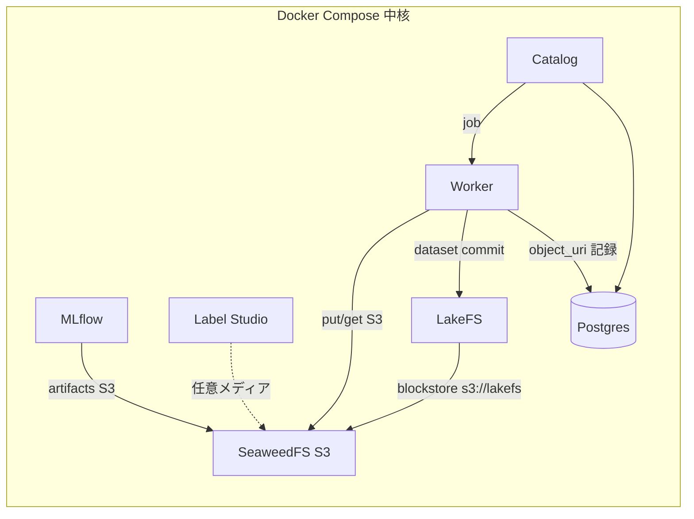

# 設計: オブジェクトストアを SeaweedFS へ、版管理を LakeFS へ

対象: 本リポジトリの **大きいファイル層**。  
**実装ステータス（2026-11-14）:** **P4 完了** — SeaweedFS all-in-one + LakeFS 中核、`LAKEFS_REQUIRED=true`（fail-closed）。`dvc_sync` / Garage / `*.dvc` / portal DVC 表記を除去。Postgres 利用時は **`lakefs-init`** が setup API + `ugv-datasets` を作成。

関連正本: [design.md](design.md) · [workflow.md](workflow.md) · [dataset.md](dataset.md)

---

## 1. 目的と非目的

### 目的

| 置き換え | From（現状） | To（目標） | ねらい |
|----------|--------------|------------|--------|
| オブジェクトストア | Garage（S3 互換。四脚では MinIO） | **SeaweedFS**（S3 API） | 単一ノード〜将来の分散に耐える S3 層。運用・容量の見通し |
| 大きい成果物の版 | **DVC**（`*.dvc` + `s3://dvc`） | **LakeFS**（ブランチ/コミット） | Git 風のデータ版を第一級にする。ポインタ二重管理をやめる |

### 非目的（この設計では変えない）

- Catalog DB が **学習に使う ID の正**（`dataset_version` / `model_version` / `object_uri`）であること
- 11 工程の API 契約とポータル
- CARLA / host worker / Label Studio / MLflow の役割
- Harbor / Nexus の導入（別層。不要方針は維持）
- 車載 TensorRT

---

## 2. 現状 → 目標の対応

```text
四脚 MinIO  ──(本PJで既に)──► Garage ──(本設計)──► SeaweedFS
四脚 DVC    ──(本PJ)────────► DVC+Garage dvc ──► LakeFS（第一級）
任意 LakeFS ──(本PJ full)───► 副次コミット ──► 既定・必須寄り
```

| 層 | 現状 | 目標 |
|----|------|------|
| バイト実体 | Garage `:9000` → コンテナ `garage:3900` | SeaweedFS S3 `:9000`（filer/S3 ゲート） |
| バケット | `raw curated datasets models packages mlflow lakefs dvc` | `raw curated datasets models packages mlflow lakefs`（**`dvc` 廃止**） |
| データ版 UI/API | DVC CLI + Git `*.dvc` | LakeFS UI `:8001` + REST / S3 Gateway |
| 学習が読む URI | 主に `s3://datasets/...`（Garage 直） | 当面同じ。段階的に `lakefs://…` または LakeFS S3 gateway 経由を選択可 |
| LakeFS 失敗時 | DVC/LakeFS 失敗でも学習継続 | **推奨方針:** 移行期（P1–P3）は `LAKEFS_REQUIRED=false` で fail-soft（Catalog/S3 学習は継続、結果に `lakefs.ok=false`）。**P4 完了後は fail-closed**（ingest / dataset の LakeFS commit 失敗 = ジョブ失敗） |

---

## 3. 目標アーキテクチャ



### 3.1 SeaweedFS

| 項目 | 設計 |
|------|------|
| 役割 | 全バケットのバイトストア（旧 Garage / 四脚 MinIO） |
| 公開 | ホスト `localhost:9000`（S3）、管理用ポートは compose で固定 |
| クライアント | 既存 `ugv_mlops.storage`（minio SDK / path-style）。endpoint と credential だけ差替え |
| 初期化 | `garage_init.py` 相当を `seaweed_init` に置換（バケット作成 + キー） |
| MLflow / LS | `MLFLOW_S3_ENDPOINT_URL` / AWS_* を SeaweedFS に向ける |
| 単一ノード既定 | **`weed server -s3` all-in-one（単一バイナリ）**。開発・オンプレ1台向け。将来分散が必要なら volume 分離を別設計 |

**バケット契約（維持）**

| バケット | 用途 |
|----------|------|
| `raw` | ingest 原本・展開 |
| `curated` | 予約 |
| `datasets` | 学習 zip（Catalog が参照する主実体） |
| `models` | 重み / ONNX |
| `packages` | 車載 zip |
| `mlflow` | MLflow 成果物 |
| `lakefs` | LakeFS ブロックストア専用 |

`dvc` バケットは移行完了後削除。

### 3.2 LakeFS（DVC の置き換え）

| 項目 | 設計 |
|------|------|
| 役割 | **大きいデータの版管理の正**（旧 DVC） |
| プロファイル | `full` 任意 → **中核依存**（または既定起動） |
| ブロックストア | SeaweedFS `s3://lakefs` |
| リポジトリ | 既定 `ugv-datasets`。将来 `ugv-raw` / `ugv-models` を分割可 |
| ブランチ | `main` = ゲート相当の安定線。作業は `ingest/<mission>` や `ds/<id>` を推奨（段階2） |
| Worker 動作 | `attach_dataset_remotes` から DVC を外し、LakeFS commit を主経路に。**raw mission も** `raw/missions/<mission_id>/` へ commit |
| 対象パス | `datasets/...` に加え **`raw/missions/<mission_id>/`**（ingest 完了時） |
| Git 上の `*.dvc` | 新規禁止。既存ポインタは移行後アーカイブ（Garage 実体のコピー移行はしない） |

**Catalog との役割分担（重要）**

| 関心 | 正 |
|------|----|
| 学習ジョブが開くデータセット ID | Postgres `dataset_version_id` |
| ファイル実体の第一 URI（当面） | `s3://datasets/<id>/<ver>.zip` on SeaweedFS |
| 人間向け版履歴・ブランチ・差分 | LakeFS commit / branch |
| ポリシー・ゲート | Catalog + `artifact_policy.yaml` |

LakeFS は「Git for data」。Catalog は「任務パイプラインの台帳」。二重の正を作らない。

---

## 4. コード／設定の変更点（実装時チェックリスト）

### SeaweedFS

1. `docker-compose.yml`: `garage` / `garage-init` → `seaweed`（master/volume/filer）+ `seaweed-init`
2. `configs/`: Garage toml 削除、Seaweed 設定追加
3. 環境変数: `MINIO_*` 名は互換維持可。実体 endpoint を Seaweed S3 に
4. `scripts/garage_init.py` → `scripts/seaweed_init.py`（バケット一覧から `dvc` 除外）
5. healthcheck / portal integrations probe: `garage` → `seaweed`（表示名）
6. docs: design / usage / setup-windows / workflow の MinIO・Garage 表記を更新

### LakeFS ← DVC

1. LakeFS を中核 `depends_on` に（postgres + seaweed-init）
2. `integrations.attach_dataset_remotes`: DVC 呼び出し削除。LakeFS を必須（または `LAKEFS_REQUIRED=true`）
3. ingest の `dvc_sync.publish_mission` を LakeFS パスコミットに置換（例: `raw/missions/<mission_id>/`）
4. `requirements-dvc.txt` / worker DVC 依存を段階削除
5. CI・portal「DVC 状態」を LakeFS ヘルス／最新 commit に置換
6. 既存 `data/**/*.dvc` は移行スクリプトで LakeFS に import 後、リポジトリから除去

### 触らない／薄い変更

- `storage.put_file` / `get_file` のバケット契約
- ゲート・署名・package/sync
- CARLA offroad 収集

---

## 5. 移行フェーズ

| フェーズ | 内容 | 完了条件 |
|----------|------|----------|
| **P0 設計固定** | 本書を正とする。Garage/DVC 新規依存を増やさない | レビュー合意 |
| **P1 Seaweed 並行** | compose に Seaweed **all-in-one** 追加、init でバケット作成。Catalog/Worker の endpoint 切替 | smoke: put/get `raw`、MLflow health。**Garage データは移行しない**（空の Seaweed で開始） |
| **P2 切替** | Garage 停止。全サービス Seaweed のみ | 工程3→7→8 を新規データでスモーク |
| **P3 LakeFS 第一級** | **raw + datasets** が LakeFS commit。DVC push 停止。`LAKEFS_REQUIRED=false` | ingest / `datasets/build` の result に `lakefs.commit_id` |
| **P4 掃除** | `*.dvc`・`dvc` バケット・dvc_sync 削除。**`LAKEFS_REQUIRED=true`（fail-closed）**。docs 更新 | CI 緑、portal から DVC 表記消滅、LakeFS 落ちで ingest/dataset が失敗 |

ロールバック: P1–P2 は endpoint で Garage に戻せる期間を置く。実体コピーは行わないため、切替後の新データは Seaweed 側のみ。

---

## 6. リスクと緩和

| リスク | 影響 | 緩和 |
|--------|------|------|
| Seaweed S3 方言（署名・path-style） | MLflow / minio SDK 失敗 | P1 で put/get・MLflow artifact を先に検証 |
| LakeFS を fail-closed にすると学習が止まる | 運用硬度↑ | 移行中は `LAKEFS_REQUIRED=false`、安定後 true |
| Garage 旧データ参照切れ | 切替後に旧 mission が無い | **移行しない方針**。必要なら再 ingest / 再版切り。ディスク逼迫回避にもなる |
| LakeFS `latest` イメージ | 認証・API 変化 | イメージタグ固定（Label Studio と同方針） |
| Catalog URI と LakeFS URI の混在 | 参照ミス | 当面 `object_uri` は `s3://datasets/...` のまま。LakeFS は `lakefs_commit` 列 or result_json に併記 |

---

## 7. 受け入れ基準（設計レベル）

1. **Garage なし**で工程 3→11 の知覚スモークが通る（Seaweed 上）
2. **DVC CLI なし**で dataset 版が LakeFS commit として辿れる
3. Catalog の `dataset_version.object_uri` から学習が従来どおり開ける
4. docs（design / workflow）が「SeaweedFS + LakeFS」を正と書く
5. Harbor/Nexus は依然として非必須

---

## 8. 決定事項（固定・2026-11-14）

| # | 問い | 決定 |
|---|------|------|
| D1 | Seaweed 構成 | **単一バイナリ all-in-one**（`weed server -s3`） |
| D2 | LakeFS 失敗時 | **推奨どおり:** P1–P3 は fail-soft（`LAKEFS_REQUIRED=false`）。**P4 以降 fail-closed**（ingest / dataset の LakeFS 失敗 = ジョブ失敗） |
| D3 | raw も LakeFS に載せるか | **載せる**（`raw/missions/<mission_id>/` + `datasets/...`） |
| D4 | Garage データ移行 | **不要**。Seaweed は空開始。旧データが要る場合は再 ingest |

---

## 9. 実装ステータス（2026-11-14 完了）

1. ~~SeaweedFS all-in-one compose + init + storage endpoint 切替~~  
2. ~~LakeFS 中核化 + `lakefs-init` + 短 ingest→dataset→train~~  
3. ~~P4: `LAKEFS_REQUIRED=true`、DVC・Garage 残骸削除、portal/docs 一掃~~  
4. ~~受け入れ: 知覚 3→11（ONNX package/sync）+ AutoE2E demo train→gate（`mdl_30124649754b`）~~  

正本ドキュメント（[design.md](design.md) / [workflow.md](workflow.md) / [architecture.md](architecture.md) / [diagrams.md](diagrams.md)）は **SeaweedFS + LakeFS** を現状として記述する。  

