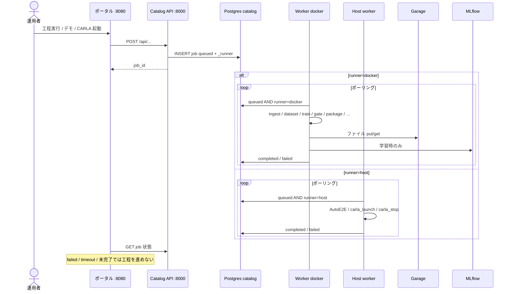
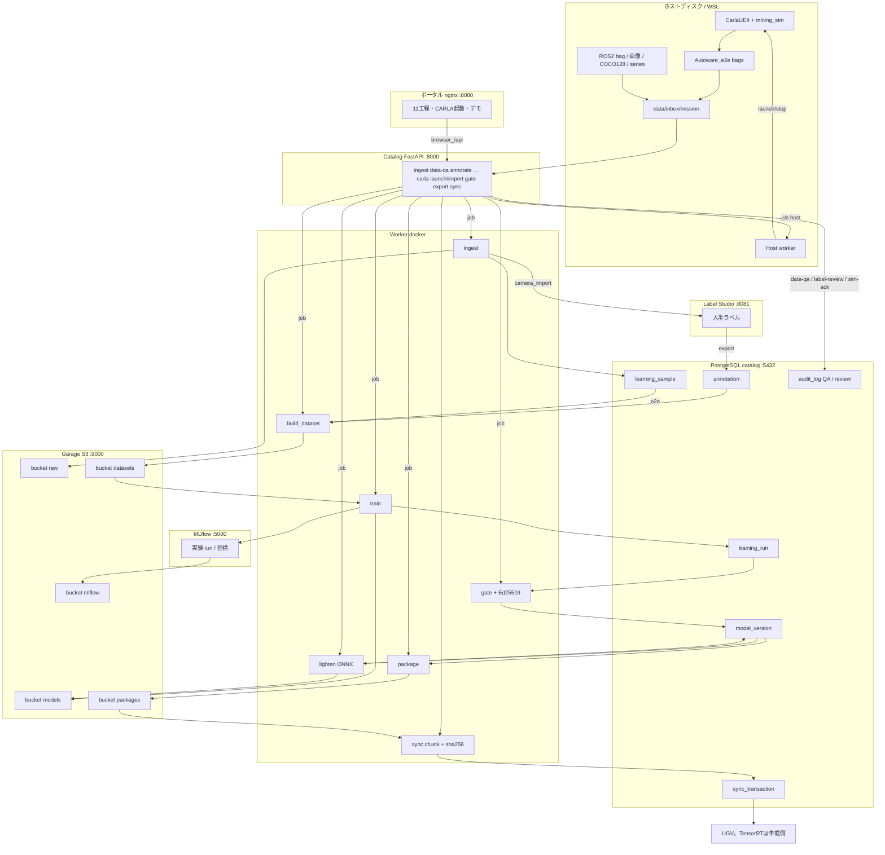
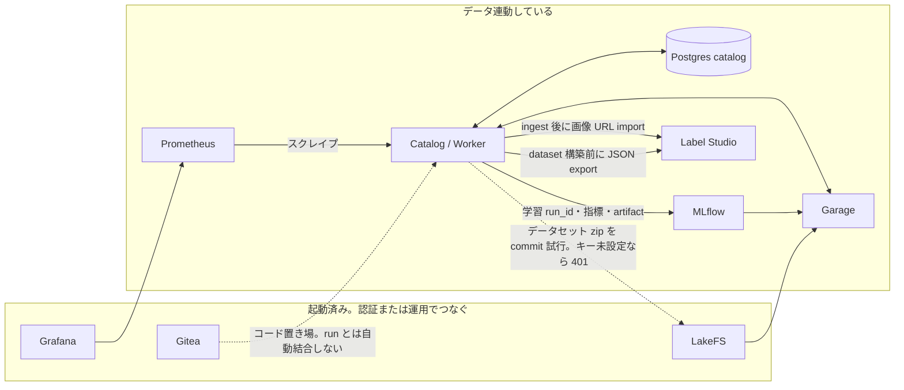
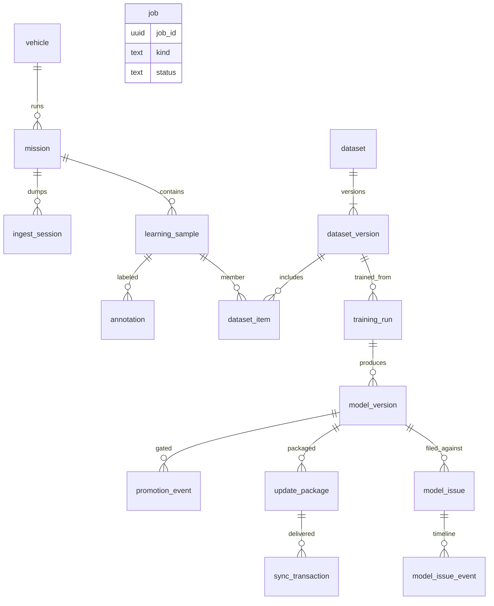

# UGV オンプレ MLOps 設計書

本書は、このリポジトリが **何を・どの順で・どのツールに渡すか** を固定する。四脚 PJ との層対応と日常の順は [workflow.md](workflow.md)、**11 工程の定義**は [pipeline-stages.md](pipeline-stages.md)、**学習タスク**は [tasks.md](tasks.md)、**AutoE2E 連携**は [autoe2e.md](autoe2e.md)、**CARLA**は [carla.md](carla.md)、**CI/CD・テスト**は [ci-cd-testing.md](ci-cd-testing.md)、使い方は [usage.md](usage.md)、新規 Windows 構築は [setup-windows.md](setup-windows.md)、フォルダ契約は [dataset.md](dataset.md)、起動・閉鎖網は [airgap.md](airgap.md)。

---

## 1. 一言で言うと

UGV が持ち帰ったデータ（ROS2 bag / 画像 / センサ / 公開サンプル）を、**学習に使える版** にし、**ゲートを通ったモデルだけ** を車載へ戻す。クラウドは使わない。OSS を 1 台の Docker Compose に載せる。

人が見る入口は http://localhost:8080（ポータル）。工程の実行は Catalog API（http://localhost:8000）。重い処理は Worker がカタログのジョブを拾って回す。**GPU / CARLA 起動**は compose 外の **ホストワーカー**（`runner=host`）が拾う。

```text
人が触る          制御の中枢                    実体
---------         -----------                  ------
ポータル ──API──► Catalog ──job──► Worker(docker) ──S3──► Garage
Label Studio              │            └── Host worker（AutoE2E / CARLA launch）
MLflow UI                 └── PostgreSQL (catalog DB)
```

既定起動はこの中核だけ。車載パッケージ／Git 風データ版／監視は `--profile full`。知覚は **アノテーション必須**（四脚シミュのように教師が自動では付かない）。失敗は **偽成功にしない**（ゲート・同期・ポータルのジョブ待ち・シミュ確認は fail-closed）。

**迷ったらこれだけ覚える。**

| 疑問 | 答え |
|------|------|
| いま何が起きているか | `job` テーブルとポータル |
| ファイルはどこか | Garage（バケットが種類。S3 互換） |
| ID とラベルはどこか | PostgreSQL `catalog` |
| 学習指標の画面は | MLflow |
| 車載に載せてよいか | ゲート通過後の `model_version` だけ |
| CARLA は誰が起動するか | host worker / CLI（compose には載せない） |
| PR で何が自動か | L1 unit（[ci-cd-testing.md](ci-cd-testing.md)） |

---

## 2. システムの位置づけ

UAIS 4 層のうち、本スタックは **層3（学習 DB）と前線学習（既定 S3）** である。火力統制とは分離する。

| 層 | 系統 | 本環境 |
|----|------|--------|
| 0 エッジ | 車載 DB・推論 | 更新パッケージの宛先。同期の受信側 |
| 1 一次 | 管制の生受信 | `data/inbox/<mission>/` へコピー |
| 2 二次 | COP／DSS の判断 | `annotation` へ合流（Label Studio または labels.jsonl） |
| 3 学習 | 隔離セグメント | Catalog + Garage + MLflow + ゲート |

学習段（`configs/artifact_policy.yaml`）:

| 段 | 場所 | 本スタックでの意味 |
|----|------|-------------------|
| S0 | 車載・推論固定 | 学習しない。パッケージ適用後の状態 |
| S1 | 車載適応 | 小さい成果物のみ（アダプタ等）。フル重み不可 |
| S2 | 戦域集約 | 任意。蒸留・プロトタイプ程度 |
| S3 | 前線拠点 | **既定の学習場所**。joblib / YOLOX 重み可 |
| S4 | 後方 | 同一 compose を `DEFAULT_LEARNING_STAGE=S4` で複製 |

---

## 3. 構成要素（Docker サービス）

`docker-compose.yml` のサービスと、**パイプライン上の役割**。ポートはホストから見た番号。

**既定（プロファイルなし）= 中核。** ROS2 bag 取得 → パース → アノテーション → データセット生成 → 学習結果管理。

| サービス | ポート | 役割 | パイプライン上の位置 |
|----------|--------|------|----------------------|
| **portal** (nginx) | 8080 | ダッシュボードと工程画面 | UI。`/api/` を Catalog に転送 |
| **catalog** | 8000 | FastAPI。ジョブ投入・照会・ダッシュボード集計 | **制御の入口** |
| **worker** | なし | ジョブ実行（取込・学習・ゲート） | **実行エンジン**。YOLOX 用に PyTorch 入り |
| **postgres** | 5432 | DB: `catalog` / `mlflow` / `labelstudio`（`lakefs` は拡張用に空作成） | メタデータの本体 |
| **garage** | 9000 / 3903 | S3 互換オブジェクトストア（Deuxfleurs Garage） | **ファイルの本体** |
| **mlflow** | 5000 | 実験追跡。成果物は Garage `mlflow` | 学習の記録 UI |
| **labelstudio** | 8081 | 人手ラベル | 知覚分類のラベル源 |

**拡張（`docker compose --profile full up -d`）。** 学習ループには不要。

| サービス | ポート | 役割 | パイプライン上の位置 |
|----------|--------|------|----------------------|
| **lakefs** | 8001 | データセットの Git 風版管理。ブロックは Garage `lakefs` | 任意。版の正は Postgres `dataset_version` + Garage zip |
| **gitea** | 3000 | 学習コードとポリシー YAML | コード版。学習ジョブとは自動紐付けしない |
| **prometheus** | 9090 | Catalog `/metrics` をスクレイプ | 監視 |
| **grafana** | 3001 | Prometheus を見る | 監視 UI。学習ループには入らない |
| **redis** | 6379 | 未使用のジョブキュー候補 | **配線していない**。ジョブは Postgres `job` |

PostgreSQL は 1 コンテナ、DB は用途で分ける（`schemas/00-init.sh`）。Catalog が読むのは **`catalog` だけ**。MLflow / Label Studio / LakeFS は各自の DB を持つ。LakeFS が止まっていてもデータセット zip の作成は通る（コミット失敗は記録だけ）。

Worker と Catalog は同じ Python パッケージ（`src/ugv_mlops`）だがイメージが違う。Catalog は API 用の薄いイメージ、Worker は YOLOX のため CPU PyTorch と公式 YOLOX を含む。

---

## 4. 制御フロー（ジョブの回り方）

学習そのものは API プロセスの中では走らない。API は `job` 行を 1 本挿入し、Worker が `queued` を拾う。`payload_json._runner` が `docker`（compose worker）か `host`（GPU ホストワーカー）かを決める（`jobs.runner_for`）。



ジョブ種別（`src/ugv_mlops/jobs.py`。主なもの）:

| kind | runner | 中身 |
|------|--------|------|
| `ingest` | docker | bag / フォルダを Garage `raw` と `learning_sample` へ |
| `build_dataset` | docker（`autoe2e` は host） | ラベル済みから zip を `datasets` へ |
| `train` | docker（`autoe2e` は host） | データセット版を学習。タスクで分岐 |
| `gate` | docker | 指標判定・署名・`model_version`（実体サイズ必須） |
| `package` | docker | 車載 zip を `packages` へ |
| `data_qa` / `label_review` / `sim_generate_ack` | docker | 確認。不足ならジョブ失敗 |
| `carla_import` | docker | Autoware bag → `data/inbox` |
| `carla_launch` / `carla_stop` | **host** | CarlaUE4 / mining_sim の起動・停止 |
| `lighten` | docker | ONNX / adapter。失敗は偽成功しない |
| `demo` / `demo_e2e` / `demo_yolox` | docker | 上記をコード内で一気通貫 |

ポータルは nginx が `/api/` を `http://catalog:8000/` にプロキシする。ブラウザは 8080 だけ見ればよい。工程 UI はジョブが `failed` / `timeout` / 未完了のとき **次工程へ進めない**。

---

## 5. データフロー（必須）

実体は Garage（S3）、関係は Catalog DB。両者を **同じ ID** で結ぶ。

### 5.1 ID の鎖（これが構造の本体）

```text
mission_id
    └─ learning_sample.sample_id     （ファイル SHA-256 の先頭 16 桁 smp_…）
           ├─ annotation             （class / bbox。E2E は操作系列が教師でラベル不要）
           └─ dataset_item
                  └─ dataset_version_id
                         └─ training_run.run_id     ＝ MLflow run_id
                                └─ model_id
                                       ├─ package_id
                                       │      └─ sync_transaction.tx_id → vehicle_id
                                       └─ issue_id（デプロイ後の課題）
                                              └─ model_issue_event（open → in_progress → resolved）
```

ファイル URI は常に `s3://<bucket>/<key>`。Catalog の `object_uri` が Garage 上の実体を指す。

### 5.2 Garage バケット

| バケット | 何が入るか | 誰が書く |
|----------|------------|----------|
| `raw` | bag 原本、展開 JPEG、imu/gnss/odom/action/lidar の jsonl | ingest |
| `curated` | 将来のスクラブ後（現状パイプライン未使用） | — |
| `datasets` | 版付き zip（ImageFolder / COCO / E2E records） | build_dataset |
| `models` | joblib または `yolox_nano.pth` | train |
| `packages` | 署名付き車載 zip | package |
| `mlflow` | MLflow サーバが置く実験アーティファクト | MLflow |
| `lakefs` | LakeFS のブロックストア | LakeFS |
| `dvc` | DVC キャッシュ（ポインタは Git の `*.dvc`） | ingest / dataset の区切り |

### 5.3 入力から車載までの一本線（11 工程）

詳細な定義・スキップ規則は [pipeline-stages.md](pipeline-stages.md)。**枠の名前がツール。** 矢印のラベルが Catalog の API。Gitea / Grafana / Redis / CARLA / TensorRT はこの線の compose 外（同じホストにいるだけ、または車載側）。

機密区分が `UNCLASSIFIED` でないサンプルは、`declassified = true` になるまでデータセットに入らない。



段とツールの対応（11 工程）:

| 段 | 人が触る / API | 実行 | ファイルの置き場 | ID の置き場 |
|----|----------------|------|------------------|-------------|
| 1 シミュ | `POST /carla/launch` → import → `sim-generate` ack | host（起動）+ docker（取込） | CARLA bag → inbox | `audit_log`（**mission + bag 実体必須**） |
| 2 置く | ホスト `data/inbox` | — | ディスク | — |
| 3 取込 | `POST /ingest` | docker worker | Garage `raw` | `learning_sample` |
| 4 データ確認 | データタブ + `POST /data-qa` | Catalog / job | — | `audit_log`（不合格はジョブ失敗） |
| 5 ラベル | Label Studio / SALT / SAM | Worker import/export | Garage `raw` 中継 | `annotation`（LS 失敗はジョブ失敗） |
| 6 ラベル確認 | Xtreme1 `:8190` + `POST /label-review` | compose 外 UI | `data/annotate` | `audit_log` |
| 7 データセット | `POST /datasets/build` | docker / host(`autoe2e`) | Garage `datasets` | `dataset_version` |
| 8 学習 | `POST /train` / MLflow | docker / host(`autoe2e`) | Garage `models` / `mlflow` | `training_run` |
| 9 ゲート | `POST /gate` | docker worker | — | `model_version`（**artifact_uri + size>0**） |
| 10 軽量化 | `POST /models/export` | docker worker | Garage `models` | 新 `model_version`（失敗は偽成功しない） |
| 11 梱包・同期 | `POST /packages` + `/sync` + chunk | Catalog | Garage `packages` → vehicle inbox | `update_package` / `sync_transaction`（**sha256/size 必須**） |

ポータル :8080 は nginx が `/api/` を Catalog :8000 に転送するだけ。Garage に Web コンソールはない。CARLA / TensorRT / SALT / Xtreme1 は本 compose に載せない（起動指示だけ Catalog→host）。

### 5.4 タスクごとの中身

学習は `dataset.task` で分岐する（`train_from_dataset`）。**運用向けの一覧・確認方法・未配線領域**は [tasks.md](tasks.md)。

| タスク | 入力 | 教師 | 成果物 | ゲート指標 | MLflow 実験 | 実行 |
|--------|------|------|--------|------------|-------------|------|
| `obstacle_cls` | カメラ JPEG | `label_type=class`（clear / obstacle / person） | `model.joblib` | accuracy, FPR | `ugv-obstacle-cls` | Docker worker |
| `detection` | カメラ JPEG | `label_type=bbox`（COCO 80 クラス可） | `yolox_nano.pth` | map50 | `ugv-yolox` | Docker worker |
| `e2e` | カメラ + `action` 系列（cmd_vel 等） | 同時刻の steer / speed。人手ラベル不要 | `model.joblib` | mae_steer, mae_speed | `ugv-e2e` | Docker worker |
| `autoe2e` | rosbag2 → scene zip | Autoware 切出し。人手ラベル不要 | `full_weights` | ADE/FDE 系 | AutoE2E 実験 | **ホスト GPU ワーカー** |

ROS2 bag 取込時の展開（ホストに ROS 不要、Python `rosbags`）:

| bag の中身 | Catalog `modality` | Garage 上 |
|------------|-------------------|----------|
| Image / CompressedImage | `camera_front` 等 | JPEG |
| Imu / NavSatFix / Odometry | `imu` / `gnss` / `odom` | jsonl 1 本 |
| Twist / Ackermann / cmd_vel | `action` | jsonl（E2E の教師） |
| PointCloud2 / LaserScan | `lidar` | 点数メタの jsonl（点群本体は元 bag） |
| `.db3` / `.mcap` / `metadata.yaml` | `rosbag` | 原本をそのまま |

E2E はカメラ時刻と `action` を `E2E_ACTION_MAX_DT_SEC`（既定 0.25s）以内で対応付ける。IMU / GNSS / LiDAR があれば特徴に足す。

---

## 6. ツール連携（必須）

「同じ compose に載っている」と「Catalog がデータを渡している」は別である。ポータルの「データ連動 / 起動のみ」と同じ見方。



### 6.1 連動の契約（実装があるもの）

**Catalog ↔ Garage**  
Worker が `ugv_mlops.storage`（minio 互換クライアント）で put/get。バケットは上記。SHA-256 でサンプル ID を決めるため、同じファイルは同じ `sample_id`。ホストからは `http://localhost:9000`（コンテナ内は `garage:3900`）。region は `garage`、path-style。

**Catalog ↔ PostgreSQL `catalog`**  
ミッション、サンプル、アノテーション、データセット版、学習 run、モデル、パッケージ、同期、ジョブ、監査。スキーマは `schemas/01_catalog.sql`。

**Catalog ↔ MLflow**  
学習ジョブだけが Tracking URI `http://mlflow:5000` に run を書く。`training_run.run_id` は MLflow の run_id と同じ。ゲートは Catalog の `metrics_json` を見る（MLflow UI は人が見る用）。MLflow の成果物バケットは `mlflow`、Catalog が車載用に使うコピーは `models`。

**Catalog ↔ Label Studio**  
- ingest 完了後: カメラ `sample_id` をプロジェクト `UGV-obstacle-cls` に import。画像 URL は `http://localhost:8000/samples/{id}/file`（Catalog が Garage を中継）。  
- dataset 構築前: export JSON を引き、`annotation` に class を戻す。  
検出の COCO bbox や E2E は、この自動プロジェクトを使わない（bbox は `labels.jsonl`、E2E は cmd_vel）。

**Catalog ↔ DVC**  
ingest と dataset 構築の区切りで Worker が `dvc add` / `dvc push -r garage-docker`。実体は Garage `s3://dvc`。ポインタは Git の `*.dvc`。dvc 未導入や push 失敗でも Catalog の学習は続く。ホストから見る remote 名は `garage`（`:9000`）。

**Catalog ↔ SALT / Xtreme1 / SAM**  
本 compose には載せない。`POST /annotate/init` が Garage のカメラ／点群を `data/annotate/<mission>` に出す。工程5は Label Studio / SALT / SAM、工程6は Xtreme1 `:8190` で突き合わせ確認（`POST /label-review`）。結果は `annotate-import-*` で `annotation` に戻す。

**Catalog ↔ シミュ（CARLA）**  
本 compose 外（[carla.md](carla.md)）。

| API | 役割 | 実行場所 |
|-----|------|----------|
| `POST /carla/launch` / `stop` | CarlaUE4 / `mining_sim` 起動・停止 | **host job**（コンテナ内では Popen しない） |
| `GET /carla/status` | Autoware ルート・`CARLA_ROOT`・TCP `:2000` probe・runtime | Catalog |
| `GET /carla/bags` / `record-hint` | bag 一覧・録画コマンド | Catalog |
| `POST /carla/import` | 許可パス（Autoware / inbox のみ）→ `data/inbox` | docker job |
| `POST /pipeline/sim-generate` | `import` または `ack`（**mission_id + bag 実体必須**） | docker job |

設定: `CARLA_ROOT` / `CARLA_LAUNCH_MODE=wsl|native|script`。代替入口: CLI `carla-launch`、`scripts/carla-launch.ps1`、ランチャー `c`。取込後は実機と同じ ingest 線。

**Catalog ↔ ホストワーカー**  
`launcher/MLOPS_gpu_worker.bat` → `host_worker.py` が `runner=host` のジョブだけを拾う。対象: AutoE2E の dataset/train、`carla_launch` / `carla_stop`。Catalog / Postgres / Garage / MLflow は localhost ポート越し。

**Catalog ↔ 軽量化**  
ゲート合格の `model_version` から `POST /models/export` が ONNX（または既存の小さい成果物）を Garage `models` に置き、別 `model_version` を切る。変換失敗はジョブ失敗（偽成功しない）。TensorRT エンジン化は車載／Autoware 側。

**Catalog ↔ LakeFS**  
データセット zip 作成後に `ugv-datasets` の `main` へオブジェクトを置き commit する。LakeFS のインストールキーが compose と合っていないと 401 になり、**データセット自体は Garage `datasets` に残る**（学習は止まない）。DVC が既定の大きい成果物の版。

**Prometheus ↔ Catalog**  
`/metrics` をスクレイプ。Grafana は Prometheus をデータソースにする。学習ジョブの合格判定には使わない（監視・死活）。

### 6.2 同じホストにいるがパイプライン未結合

| ツール | 状態 | つなぎ方 |
|--------|------|----------|
| Gitea | HTTP で起動確認のみ | 学習コードと `artifact_policy.yaml` を置き、運用で `run_id` と commit を対応付ける。**CI は Gitea Actions で同一スクリプト可**（§6.4） |
| Grafana | 起動。パイプライン非参加 | ノード監視・（任意）CI runner / host worker 死活 |
| Redis | 起動 | 将来のキュー用。現状は Postgres `job` |

### 6.3 人が直接開く画面と、Catalog との関係

| URL | ツール | Catalog との関係 |
|-----|--------|------------------|
| :8080 | ポータル | `/api/pipeline` `/api/dashboard` `/api/carla/*`。工程はジョブ完了まで待つ |
| :8000/docs | Catalog OpenAPI | 工程の手動実行 |
| :5000 | MLflow | Worker が書いた run を閲覧 |
| :9000 | Garage S3 | バケットの中身（コンソールなし。aws s3 / Catalog 経由） |
| :8081 | Label Studio | ingest が投げたタスクを人がラベル |
| :8001 | LakeFS | データセット commit を閲覧（キー設定後） |
| :3000 | Gitea | コード。Actions で CI 可 |
| :3001 | Grafana | プロセス監視 |
| :8190 | Xtreme1（compose 外） | 工程6 突き合わせ |

### 6.4 CI/CD 管理ツールとの統合

学習パイプライン（Catalog job / MLflow）と、**リポジトリの品質ゲート（CI/CD）**は層を分ける。実行体は共通スクリプト（`pytest` / 将来の `scripts/ci-*.ps1`）に寄せ、オーケストレータだけを環境で選ぶ。詳細レイヤは [ci-cd-testing.md](ci-cd-testing.md)。

```text
[CI オーケストレータ]                [本スタック]
 GitHub Actions（開発・PR）           Catalog jobs / MLflow
 Gitea Actions（オンプレ・閉鎖網） ──► 同一 pytest / smoke スクリプト
 Jenkins / self-hosted（GPU・CARLA）   host worker / compose smoke
        │
        ▼
 Prometheus / Grafana（任意で成否・runner 死活）
```

| ツール | 本リポでの位置 | 統合点 |
|--------|----------------|--------|
| GitHub Actions | L1 unit（`.github/workflows/ci-unit.yml`） | PR 必須。`workflow` スコープ要 |
| Gitea Actions | エアギャップ向けミラー | 同じ YAML / スクリプトを Gitea で再生 |
| Jenkins 等 | L4/L5（GPU・実 CARLA・HIL） | `scripts/` と host worker を Pipeline から起動 |
| Argo CD / Flux | **非採用（既定）** | 配備は compose。K8s GitOps は対象外 |
| Catalog / MLflow | 学習・ゲート・同期の実行管理 | CI の代替ではない。CD 後の本線 |

**方針:** Continuous Delivery は staging まで自動可。**本番への Continuous Deployment は既定オフ**（承認後に compose 更新）。CI ダッシュボードをポータルに埋め込まず、Checks +（任意）Grafana を正とする。

---

## 7. Catalog 論理モデル（関係）



`audit_log` は ingest / dataset / train / gate / package / sync / job / issue を時系列で残す。説明責任用であり、学習計算には使わない。

---

## 8. 評価ゲートと車載パッケージ

ゲート（`evaluate_and_promote`）は MLflow ではなく **Catalog 上の `training_run.metrics_json`** を見る。**空成果物は通さない**（fail-closed）。

| 条件 | 参照 |
|------|------|
| 成果物 URI | `artifact_uri` 必須 |
| 成果物サイズ | 実測 `size_bytes > 0`（0 / 欠落は不合格） |
| 成果物種別 | 学習段 S0–S4 のホワイトリスト |
| 分類 | min_accuracy / max_false_positive_rate |
| 検出 | min_map50 |
| E2E | max_mae_steer / max_mae_speed |
| holdout | `n_test > 0`（staging/production とも require_holdout） |
| 任務モード | training / maintenance 等 |
| 署名 | Ed25519。`require_signature` はポリシーに従う。production は改ざん検証も |

合格したものだけ `POST /packages` できる。パッケージは `manifest.json` + 署名 + `artifact.<kind>` の zip。S1 に YOLOX フル重みを載せることはポリシー上できない（`full_weights` は S3/S4）。

同期はリンクが短い前提でチャンク送信、オフセット再開、ack / rollback（D-DIL の模擬）。実装は Catalog 内の `sync_transaction` であり、実車プロトコルの最終形ではない。**チャンク書き込みは実ファイル I/O**。受信側は **sha256 と size を必須検証**（欠落は fail-closed）。成果物は `data/work/vehicles/<vehicle_id>/inbox/` へ届く。

### 8.1 デプロイ後の課題追跡

ゲートを通った（または梱包された）モデルに対して、運用上の不具合を **起票 → 着手 → 解決** まで残す。学習ジョブとは別系統で、Catalog DB の `model_issue` / `model_issue_event` が正本。既存の Postgres ボリュームでも Catalog 起動時の `ensure_schema()` が表を足す。

```text
model_id（必須） ─ package_id（任意、最新パッケージを自動紐付け）
                 ─ vehicle_id（任意、再現した車）
                 ─ related_run_id / related_sample_id（任意）
```

| 状態 | 意味 |
|------|------|
| `open` | 未着手 |
| `in_progress` | 対応中 |
| `resolved` | 解決（`resolution` または note 必須） |
| `wont_fix` | 対応しない |
| `duplicate` | 重複 |

重要度は `low` / `medium` / `high` / `critical`。種別は誤検出・見逃し・ドリフト・遅延・安全・梱包・同期・その他。

入口:

| 入口 | 内容 |
|------|------|
| ポータル「課題」タブ | デプロイ済みモデルのドロップダウンから起票。一覧・状態ボタン・タイムライン |
| `GET /models/deployed` | staging / canary / production、または `update_package` があるモデル |
| `GET/POST /issues` `PATCH /issues/{id}` | 一覧・起票・遷移。イベントは `model_issue_event` |
| CLI `issue-open` / `issue-update` | 同じ Catalog を書く |

ダッシュボード KPI の「未解決課題」は `open` + `in_progress`。解決すると `resolved_at` が入り、再オープンで消える。

---

## 9. デモが通す経路

ポータルのデモボタンは、同じ 11 工程パイプラインを **入力だけ変えて** 回す（デモでは工程1・10を省略し、ゲートは `smoke` になり得る）。

| ボタン | 入力 | task | 学習器 |
|--------|------|------|--------|
| 知覚デモ | 合成 JPEG + class ラベル | obstacle_cls | LogisticRegression |
| E2Eデモ | 合成カメラ + imu/lidar/cmd_vel | e2e | Ridge |
| YOLOXデモ | COCO128（公開）+ 公式 nano 重み | detection | YOLOX-Nano 短 fine-tune |
| rosbag2デモ | CostNav Teleop 公開 MCAP（カメラ+LiDAR+cmd_vel） | e2e | bag 取込 → E2E Ridge。ゲートは `smoke` |

YOLOX デモの COCO128 は COCO train の部分集合なので、mAP は **パイプラインが最後まで繋がることの確認** 用である。実任務では別ミッションを holdout にする。

---

## 10. ディレクトリとコードの対応

| パス | 意味 |
|------|------|
| `docker-compose.yml` | サービスとポート、ボリューム |
| `schemas/01_catalog.sql` / `02_issues.sql` | 層3 学習 DB。課題表は既存 volume へ `ensure_schema` でも適用 |
| `configs/garage.toml` / `configs/artifact_policy.yaml` | Garage・学習段ポリシー |
| `src/ugv_mlops/api.py` | HTTP。ジョブ投入・ダッシュボード・課題・carla |
| `src/ugv_mlops/issues.py` | デプロイ済みモデルに紐づく課題 CRUD とタイムライン |
| `src/ugv_mlops/jobs.py` / `host_worker.py` | ジョブディスパッチ（docker / host） |
| `src/ugv_mlops/ingest.py` / `rosbag.py` | 取込と bag 展開 |
| `src/ugv_mlops/pipeline_qa.py` | data_qa / label_review / sim ack |
| `src/ugv_mlops/carla_bridge.py` / `carla_launch.py` | bag 取込・起動（host） |
| `src/ugv_mlops/dataset.py` / `detect_dataset.py` / `e2e.py` / `autoe2e.py` | データセット版・AutoE2E |
| `src/ugv_mlops/train.py` / `yolox_train.py` | 学習 |
| `src/ugv_mlops/gate.py` / `lighten.py` / `package.py` / `sync.py` | 合格・軽量化・梱包・配送 |
| `src/ugv_mlops/integrations.py` | LS / LakeFS / 疎通プローブ |
| `scripts/carla-launch.ps1` | ホストから CARLA 直接起動 |
| `tests/` / `requirements-dev.txt` | L1 単体。CI 設計は `docs/ci-cd-testing.md` |
| `.github/workflows/ci-unit.yml` | PR 用 L1（push に `workflow` スコープが必要な場合あり） |
| `data/inbox/` / `data/work/` | 一次データ入口・CARLA runtime / vehicle inbox |
| `services/portal/` | 8080 の画面（API はプロキシ） |
| `launcher/` | スタック起動・GPU worker・CARLA メニュー |

---

## 11. 設計上の非目標

- クラウド学習 API、外部 MLOps SaaS
- 火力統制・射撃諸元
- Redis ジョブキュー（未配線。拡張プロファイルに隔離）
- Gitea commit と `run_id` の自動結合
- 既定起動での LakeFS / Gitea / Grafana / Prometheus（`--profile full`）
- **CARLA / Genesis / TensorRT を本 `docker-compose.yml` に載せる**（起動は host 委譲のみ）
- Catalog コンテナ内から直接 `CarlaUE4` を Popen する
- 本番への自動 Continuous Deployment（承認なしの compose 更新）
- CI で常時 CarlaUE4 / 実車 sync を回す
- LiDAR 点群を PCD として学習（メタと原本 bag のみ）
- Autoware 独自メッセージで bag 内に型定義が無いものの完全デシリアライズ

---

## 12. 改訂

実装がソース・オブ・トゥルースである。本設計書とコードが食い違うときはコードを正とし、本ファイルを直す。

| 日付 | 内容 |
|------|------|
| 2026-11-02 | 11 工程・fail-closed（gate/sync/portal/sim ack）。CARLA host launch。docker/host runner。CI/CD 管理ツール統合（§6.4）。関連 [carla.md](carla.md) / [ci-cd-testing.md](ci-cd-testing.md) / [tasks.md](tasks.md) |
