# 構成図（システム / シーケンス / モジュール）と IF 仕様

正本の文言: [design.md](design.md) · [pipeline-stages.md](pipeline-stages.md) · [tasks.md](tasks.md) · [carla.md](carla.md) · [autoe2e.md](autoe2e.md) · [dataset.md](dataset.md)

対象: **本リポジトリ全体**（Docker 中核・full プロファイル・ホスト側 CARLA/AutoE2E・アノテ外部ツール・車載同期）。  
粒度: サービス単位・ジョブ kind・Python モジュール・**IF（インタフェース契約）**・SeaweedFS バケット・Catalog テーブル。置き換え詳細は [design-seaweed-lakefs.md](design-seaweed-lakefs.md)。

**IF の意味:** **外部インターフェース**（本スタックと外界）と **内部インターフェース**（スタック内コンポーネント間）。詳細は §4。

---

## 1. システム構成図

### 1.1 配置全体（論理）

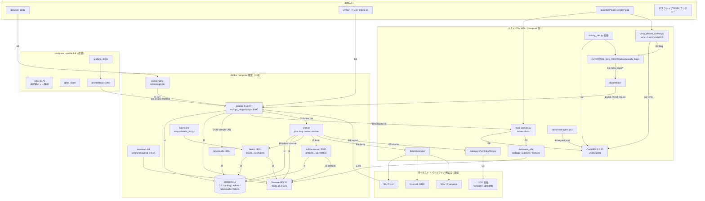

接続線のラベルが **IF ID**（E=外部 / I=内部）。定義は §4。

### 1.2 制御面とデータ面の分離

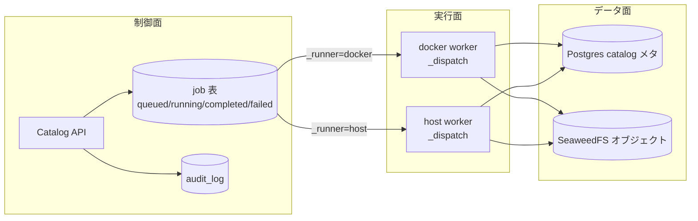

`jobs.runner_for` が host になる条件:

| kind / 条件 | runner |
|-------------|--------|
| `carla_launch`, `carla_stop` | host |
| `build_dataset` かつ `task ∈ {autoe2e, auto_e2e, autoe2e_finetune}` | host |
| `train` かつ dataset.task が上記 AutoE2E | host |
| その他 | docker |

### 1.3 SeaweedFS バケットと書き手

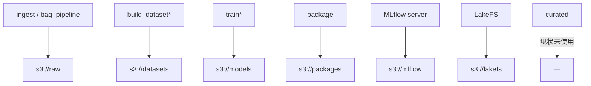

---

## 2. シーケンス図

### 2.1 ジョブ実行の共通シーケンス（全工程の骨格）

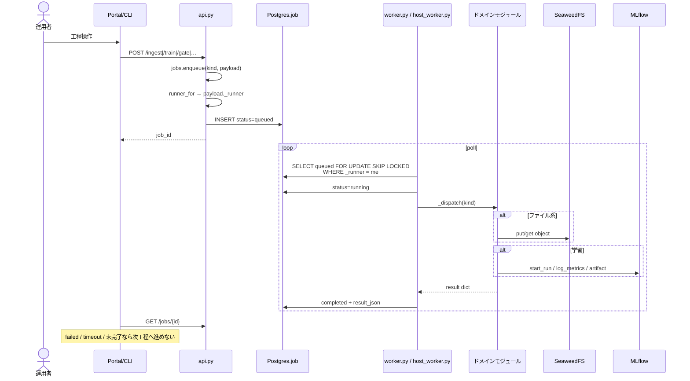

### 2.2 取得フェーズ（工程1–4）

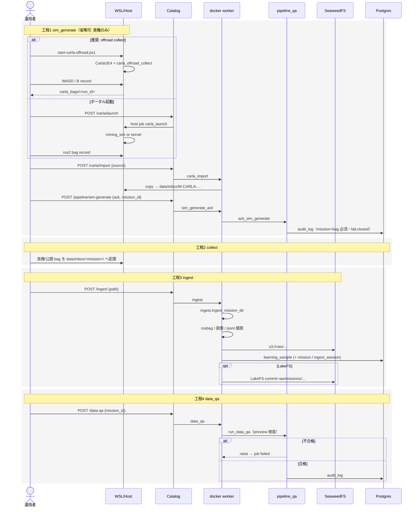

### 2.3 教師フェーズ（工程5–6）※知覚必須 / E2E・AutoE2E はスキップ可

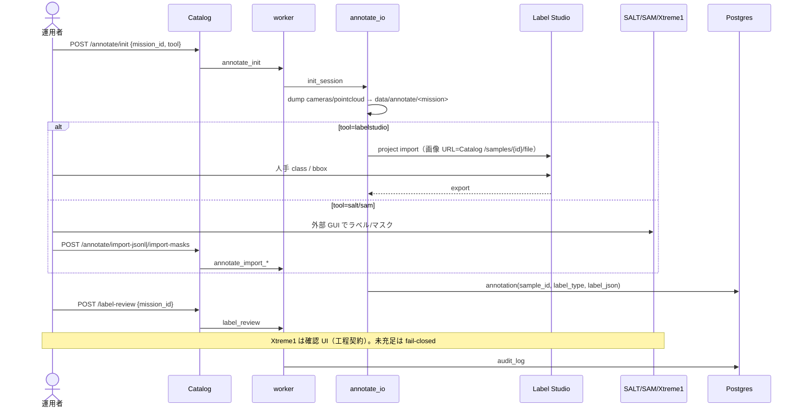

### 2.4 学習フェーズ（工程7–9）※タスク分岐

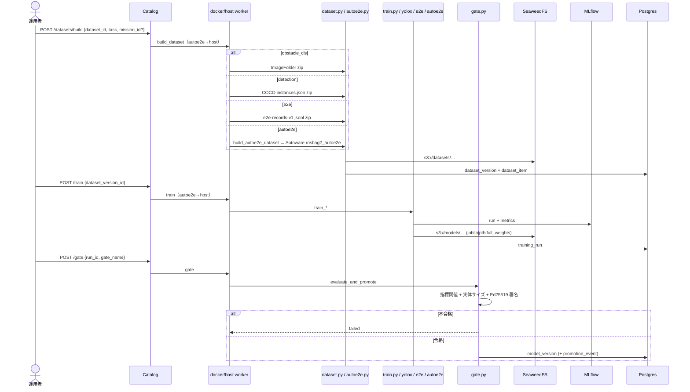

### 2.5 配備フェーズ（工程10–11）

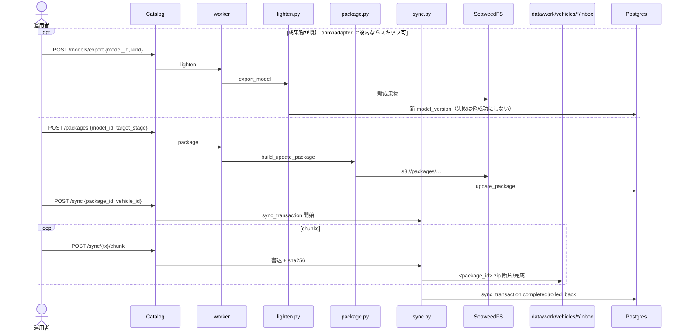

### 2.6 ID の鎖（データの寿命）

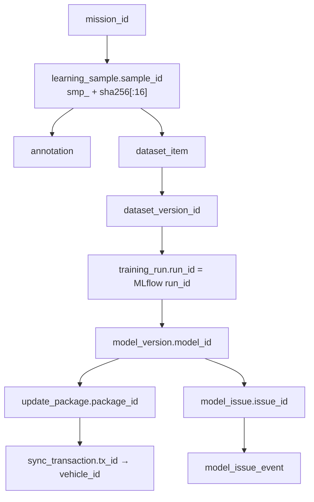

---

## 3. モジュール構成図

### 3.1 パッケージ地図

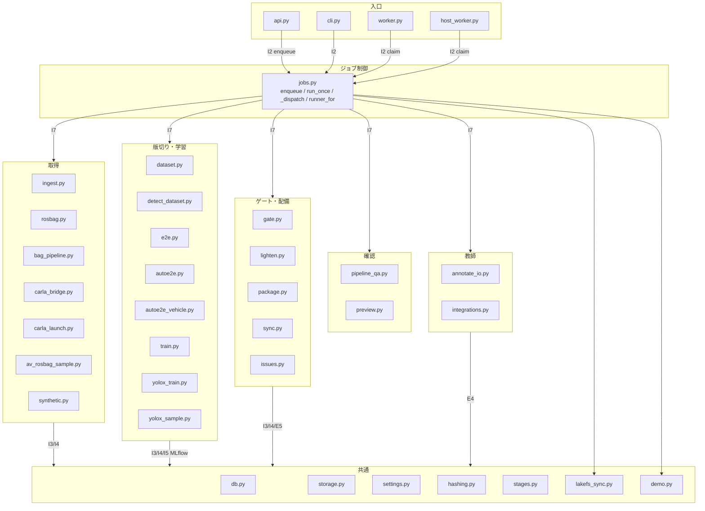

モジュール図の矢印ラベルも IF ID。学習系は **I5（MLflow）** を必ず経由する。

### 3.2 ジョブ kind → モジュール（IF 詳細は §4）

| job kind | モジュール関数 | runner | 相手 IF |
|----------|----------------|--------|---------|
| `ingest` | `ingest.ingest_mission_dir` | docker | inbox FS + SeaweedFS + LakeFS + `learning_sample` |
| `bag_parse` / `bag_track` / `bag_store` | `bag_pipeline.*` | docker | mission FS + SeaweedFS + LakeFS |
| `carla_import` | `carla_bridge.import_bag_to_inbox` | docker | 許可パス → inbox |
| `carla_launch` / `carla_stop` | `carla_launch.*` | **host** | `request.json` / UE4 プロセス |
| `sim_generate_ack` / `data_qa` / `label_review` | `pipeline_qa.*` | docker | audit_log（fail-closed） |
| `annotate_*` | `annotate_io.*` | docker | annotate dump / LS / jsonl |
| `build_dataset` | `dataset.build_dataset` | docker / **host(autoe2e)** | samples → `dataset_version` + S3 |
| `train` | `train_*` / `autoe2e.train_autoe2e` | docker / **host(autoe2e)** | dataset → run + models + MLflow |
| `gate` | `gate.evaluate_and_promote` | docker | metrics → `model_version` |
| `lighten` | `lighten.export_model` | docker | model → 新 model_version |
| `package` | `package.build_update_package` | docker | model → `update_package` |
| `lakefs_publish` | `lakefs_sync.*` | docker | LakeFS `ugv-datasets`（旧 `dvc_publish` は廃止） |
| `demo*` | `demo.run_*` | docker | 上記を内包 |

### 3.3 タスク別・版切り／学習の入出力

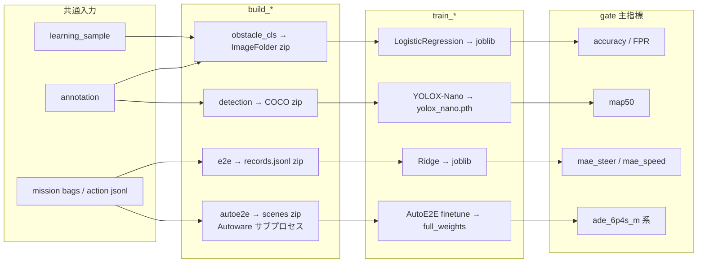

| task | 版切り format | 学習モジュール | 成果物 kind | ゲートキー |
|------|---------------|----------------|-------------|------------|
| `obstacle_cls` | imagefolder | `train.train_obstacle_classifier` | joblib | accuracy, false_positive_rate |
| `detection` | coco-detection-v1 | `yolox_train.train_yolox` | full_weights | map50 |
| `e2e` | e2e-records-v1 | `e2e.train_e2e` | joblib | mae_steer, mae_speed |
| `autoe2e` | autoe2e-scenes-v1 | `autoe2e.train_autoe2e` | full_weights | ade_* / 改善比 |

### 3.4 Catalog HTTP（工程に直結する POST）

| 工程 | API | enqueue kind |
|------|-----|--------------|
| 1 | `POST /carla/launch`, `/carla/import`, `/pipeline/sim-generate` | carla_launch, carla_import, sim_generate_ack |
| 3 | `POST /ingest` | ingest |
| 4 | `POST /data-qa` | data_qa |
| 5 | `POST /annotate/init`, `/annotate/import-*` | annotate_* |
| 6 | `POST /label-review` | label_review |
| 7 | `POST /datasets/build` | build_dataset |
| 8 | `POST /train` | train |
| 9 | `POST /gate` | gate |
| 10 | `POST /models/export` | lighten |
| 11 | `POST /packages`, `/sync`, `/sync/{tx}/chunk` | package + sync 直実行 |

補助: `GET /pipeline`, `/dashboard`, `/jobs`, `/samples`, `/missions/*`, `/carla/*`, `/autoe2e/status`, `/integrations`, `/lakefs`, `/inbox`, `/issues*`。

### 3.5 ホスト側スクリプトモジュール（compose 外）

| スクリプト | 入力 | 出力 |
|------------|------|------|
| `setup-carla.ps1` / `setup-carla-wsl.sh` | Download フラグ | `~/CARLA`, `.env` CARLA_* |
| `setup-carla-offroad.ps1` / `*-env.sh` | CARLA_ROOT | `~/.venv-carla915`, Mine_01 試行 |
| `start-carla.ps1` / `run-carla-wsl.sh` | MODE=window/offscreen | CarlaUE4, :2000 |
| `start-carla-offroad.ps1` / `_launch_collect.sh` | Map, SkipServer | collect プロセス |
| `carla_offroad_collect.py` | RPC, キー, --map/--sync | rosbag2 (image/odom/speed) |
| `carla-host-agent.ps1` | `data/work/carla/request.json` | launch/stop 実行 |
| `launcher/MLOPS_gpu_worker.*` | — | `host_worker` 常駐 |
| `launcher/MLOPS_run.*` | メニュー選択 | compose up / ポータル / デモ |

### 3.6 Postgres（catalog）主要テーブル

| テーブル | 役割 |
|----------|------|
| `vehicle` / `mission` / `ingest_session` | 機体・任務・取込セッション |
| `learning_sample` | 学習原子（modality, object_uri, sha256） |
| `annotation` | class / bbox / mask 等 |
| `dataset` / `dataset_version` / `dataset_item` | 版とメンバー |
| `training_run` | MLflow run と指標 JSON |
| `model_version` / `promotion_event` | 合格モデルと昇格 |
| `update_package` / `sync_transaction` | 梱包と配送トランザクション |
| `job` / `audit_log` | 非同期実行と監査 |
| `model_issue` / `model_issue_event` | デプロイ後課題 |

---

## 4. インターフェース仕様（外部 IF / 内部 IF）

分類:

| 区分 | 定義 |
|------|------|
| **外部 IF** | 本 MLOPS スタックの境界をまたぐ。運用者・車載・CARLA/Autoware・外部 GUI・公開データ源など |
| **内部 IF** | compose 内外を問わず、**本リポジトリが所有するコンポーネント同士**の契約 |

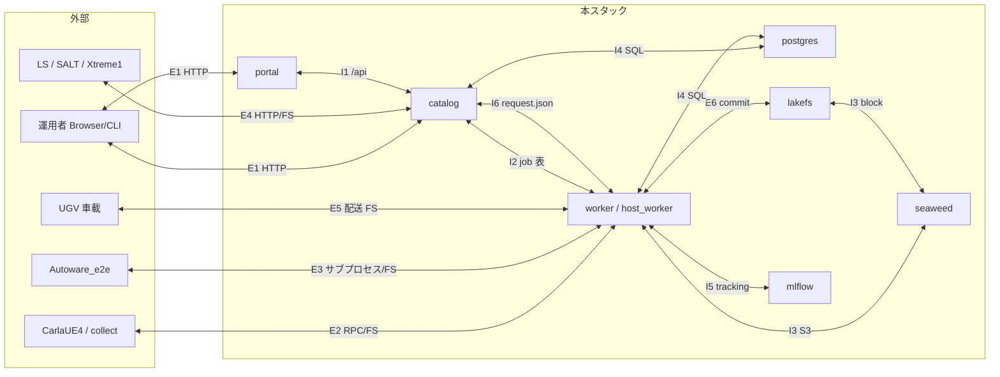

---

### 4.1 外部 IF

#### E1 — 運用者 ↔ Catalog / Portal（HTTP）

| 項目 | 契約 |
|------|------|
| 公開面 | Portal `http://localhost:8080`（nginx が `/api/` → `catalog:8000`） |
| 直結 | Catalog `http://localhost:8000`（OpenAPI `/docs`） |
| 認証 | 現状なし（オンプレ前提） |
| 非同期応答 | 多くの POST は `{ "job_id": "<uuid>" }` のみ。完了は `GET /jobs/{job_id}` |
| 同期応答 | `POST /sync`, `POST /sync/{tx}/chunk` 等は結果 dict を即返す |

**工程 POST リクエストボディ（Pydantic = 正本 `api.py`）**

| IF ID | Method Path | Request | 備考 |
|-------|-------------|---------|------|
| E1-ingest | `POST /ingest` | `{path, source_type?}` | path 必須・存在チェック |
| E1-ds | `POST /datasets/build` | `{dataset_id, name?, task?, mission_id?, autoe2e_rig?, prepare_pose?}` | task 既定 `obstacle_cls` |
| E1-train | `POST /train` | `{dataset_version_id, stage?, params?}` | autoe2e は params.epochs 等 |
| E1-gate | `POST /gate` | `{run_id, gate_name?, target_status?, mission_mode?}` | |
| E1-pkg | `POST /packages` | `{model_id, target_stage?}` | |
| E1-sync | `POST /sync` | `{package_id, vehicle_id?}` | → `{tx_id,...}` |
| E1-chunk | `POST /sync/{tx_id}/chunk?max_bytes=` | — | チャンク進捗 |
| E1-qa | `POST /data-qa` | `{mission_id, confirm?, note?}` | |
| E1-rev | `POST /label-review` | `{mission_id, confirm?, note?}` | |
| E1-ann | `POST /annotate/init` | `{mission_id, kind?, limit?, tool?}` | |
| E1-ann-m | `POST /annotate/import-masks` | `{session, masks_dir?, tool?}` | |
| E1-ann-j | `POST /annotate/import-jsonl` | `{path, tool?}` | |
| E1-carla-L | `POST /carla/launch` | `{components?, dry_run?, wait_ready_sec?, sync?}` | host job |
| E1-carla-S | `POST /carla/stop` | `{components?, sync?}` | host job |
| E1-carla-I | `POST /carla/import` | `{source, mission_id?, note?}` | |
| E1-sim | `POST /pipeline/sim-generate` | `{action, note?, mission_id?, source?}` | `ack`\|`import` |
| E1-exp | `POST /models/export` | `{model_id, kind?, target_stage?}` | lighten |
| E1-demo | `POST /demo*` | `{}` | demo / demo-e2e / demo-yolox / demo-rosbag |

**観測 GET（抜粋）:** `/health` `/status` `/pipeline` `/dashboard` `/jobs` `/jobs/{id}` `/samples` `/samples/{id}/file` `/datasets` `/models` `/packages` `/inbox` `/missions*` `/carla/status` `/carla/bags` `/autoe2e/status` `/integrations` `/lakefs` `/issues*` `/metrics`

**失敗契約:** HTTP 4xx（例: ingest path 不存在）。ジョブ失敗は `job.status=failed` + `error`。ポータルは failed/timeout/未完了で次工程を進めない。

---

#### E2 — CARLA / 収集クライアント ↔ 本スタック

| IF ID | 相手 | プロトコル | 契約 |
|-------|------|------------|------|
| E2-rpc | CarlaUE4 | TCP RPC `:2000` / streaming `:2001` | ホスト/WSL。Catalog は接続しない |
| E2-collect | `carla_offroad_collect.py` | ファイル | 出力: `{AUTOWARE_E2E_ROOT}/datasets/carla_bags/<run_id>/`（rosbag2 v9） |
| E2-topics | bag トピック | ROS2 CDR | `/carla/ego_vehicle/rgb/image` (`sensor_msgs/Image` bgr8), `/odometry` (`nav_msgs/Odometry`), `/speed` (`std_msgs/Float32`) |
| E2-import | `carla_bridge` | FS コピー | 許可ルート（Autoware bags / 絶対パス制約）→ `data/inbox/M-CARLA-*` |
| E2-launch | host agent | 共有 FS | 下記 **I6**（内部だが外部プロセスが読む）経由で UE4 起動 |

起動モード設定（外部環境）: `CARLA_ROOT`, `CARLA_LAUNCH_MODE=wsl|native|script`, `CARLA_HOST/PORT`。

---

#### E3 — Autoware_e2e ↔ host_worker（AutoE2E）

| IF ID | 契約 |
|-------|------|
| E3-root | `.env` `AUTOWARE_E2E_ROOT` |
| E3-py | `AUTOE2E_PYTHON` または `<root>/.venv-autoe2e/python` |
| E3-rig | `AUTOE2E_RIG` または mission 用 `data/work/autoe2e/rigs/<mission>.yaml` |
| E3-build | host `build_dataset` task=autoe2e → サブプロセス `tools/rosbag2_autoe2e` |
| E3-train | host `train` → `tools/auto_e2e_finetune_offroad.py`（CUDA 必須） |
| E3-out | scene zip → `s3://datasets`、重み → `s3://models`、指標 → MLflow |

---

#### E4 — アノテーション外部ツール

| IF ID | 相手 | 方向 | 契約 |
|-------|------|------|------|
| E4-ls | Label Studio `:8081` | 双方向 | Catalog がプロジェクト投入。画像 URL = `{SAMPLE_PUBLIC_BASE}/samples/{sample_id}/file`。認証: LS user/pass or API key（settings） |
| E4-dump | SALT / SAM / 任意 | 出 | `data/annotate/<mission>/` へカメラ・点群ダンプ（`annotate_io.init_session`） |
| E4-jsonl | SALT 等 | 入 | `POST /annotate/import-jsonl` → `annotation` |
| E4-mask | SAM freespace | 入 | `POST /annotate/import-masks` |
| E4-xt | Xtreme1 `:8190` | 確認のみ | 工程6 の確認 UI。ラベル正本は Catalog DB |

**ラベル JSON 契約（外部→内部に正規化）** — 詳細は [dataset.md](dataset.md):

```json
{"sample_id":"smp_<sha16>","label_type":"class","label_json":{"task":"obstacle_cls","class":"obstacle"},"tool":"labelstudio"}
{"sample_id":"smp_<sha16>","label_type":"bbox","label_json":{"task":"detection","boxes":[{"class":"person","class_id":0,"x":0,"y":0,"w":1,"h":1}]}}
```

---

#### E5 — UGV 車載 ↔ 配送バッファ（工程11）

| IF ID | 契約 |
|-------|------|
| E5-path | `data/work/vehicles/<vehicle_id>/inbox/<package_id>.zip` |
| E5-partial | 配送中は `*.zip.partial`、完了で rename |
| E5-integrity | `update_package.sha256` / `size_bytes` と一致必須。不一致は `sync_transaction.status=rolled_back` |
| E5-chunk | `POST /sync/{tx_id}/chunk` がバイト列を追記（既定 max 65536） |
| E5-trt | TensorRT 変換は **車載側**（本スタック外）。成果物 kind は onnx/joblib/full_weights まで |

---

#### E6 — その他の外部接点

| IF ID | 相手 | 契約 |
|-------|------|------|
| E6-inbox | 運用者 FS | `data/inbox/<mission>/` 配置契約（manifest / bag / cameras / series / labels）→ [dataset.md](dataset.md) |
| E6-lakefs | LakeFS | `lakefs://ugv-datasets/…`、ブロック `s3://lakefs`（SeaweedFS） |
| E6-prom | Prometheus | `GET /metrics` スクレイプ（学習判定には使わない） |
| E6-gitea | Gitea | コード置き場。`run_id` と自動結合しない |
| E6-pub | 公開サンプル | CostNav / COCO128 等の取得スクリプト（ネット）。成果は inbox に正規化 |

---

### 4.2 内部 IF

#### I1 — Portal ↔ Catalog

| 項目 | 契約 |
|------|------|
| 経路 | nginx `location /api/` → `http://catalog:8000/`（パス前方の `/api` を剥がす想定） |
| セマンティクス | ブラウザは 8080 のみ。Catalog の HTTP IF（E1）と同一リソース |
| タイムアウト | ポータル工程 UI はジョブ完了待ち。fail-closed |

---

#### I2 — Catalog ↔ Worker / Host worker（ジョブバス）

| 項目 | 契約 |
|------|------|
| 媒体 | Postgres `job` テーブル（Redis は未配線） |
| 投入 | `jobs.enqueue(kind, payload)` → `status=queued`, `payload_json` に `_runner` 付与 |
| 取得 | `FOR UPDATE SKIP LOCKED` + `payload_json->>'_runner' = docker|host` |
| 状態 | `queued` → `running` → `completed`\|`failed` |
| 結果 | `result_json` / `error` |
| 監査 | `audit_log` に `job.enqueued` / `job.completed` / `job.failed` |

**ジョブエンベロープ**

```json
{
  "job_id": "<uuid>",
  "kind": "ingest|train|gate|…",
  "payload_json": { "…業務フィールド…", "_runner": "docker|host" },
  "status": "queued|running|completed|failed",
  "result_json": {},
  "error": null
}
```

`runner_for` 規則は §1.2。dispatch 先は §3.2。

---

#### I3 — Worker ↔ SeaweedFS（オブジェクト）

| 項目 | 契約 |
|------|------|
| プロトコル | S3 API（endpoint `seaweed:8333` / ホストからは `:9000`） |
| URI 形 | `s3://<bucket>/<key>`（Catalog `object_uri`） |
| 認証 | AccessKey/Secret（`.env` `MINIO_ROOT_*`） |
| バケット | `raw` `datasets` `models` `packages` `mlflow` `lakefs`（§1.3） |
| 整合 | package 配送前に size + sha256 再計算一致必須 |

---

#### I4 — Catalog/Worker ↔ Postgres（メタ）

| 項目 | 契約 |
|------|------|
| DB | `catalog`（学習メタ正本）。MLflow/LS は別 DB 名 |
| スキーマ | `schemas/01_catalog.sql` / `02_issues.sql` |
| 主キー鎖 | mission → sample → annotation/dataset_item → dataset_version → training_run → model_version → update_package → sync_transaction |
| オブジェクト結合 | 各表の `object_uri` が I3 の S3 を指す |

主要カラム契約（抜粋）:

| 表 | 必須キー | 意味のある列 |
|----|----------|--------------|
| `learning_sample` | sample_id | modality, object_uri, sha256, classification, declassified |
| `annotation` | annotation_id | sample_id, label_type, label_json, tool |
| `dataset_version` | dataset_version_id | format, object_uri, stats_json |
| `training_run` | run_id | metrics_json, artifact_uri, status |
| `model_version` | model_id | artifact_kind, artifact_uri, signature_b64, status |
| `update_package` | package_id | object_uri, sha256, size_bytes, signature_b64 |
| `sync_transaction` | tx_id | status, bytes_sent, resume_offset |

---

#### I5 — Worker ↔ MLflow

| 項目 | 契約 |
|------|------|
| Tracking URI | settings `mlflow_tracking_uri`（compose 内 `http://mlflow:5000`） |
| run_id | `training_run.run_id` と同一 |
| Artifacts | MLflow 経由で `s3://mlflow` |
| 実験名 | タスク別（例: `ugv-obstacle-cls`, `ugv-e2e`, `ugv-yolox`） |

---

#### I6 — Catalog ↔ Host agent（CARLA 起動依頼）

共有ファイル: `data/work/carla/request.json`

```json
{
  "action": "launch|stop",
  "components": ["server", "mining_sim"],
  "requested_at": "<iso8601>",
  "status": "queued|running|done|failed",
  "updated_at": "<iso8601>",
  "result": {}
}
```

| 項目 | 契約 |
|------|------|
| 書き手 | Catalog（コンテナ）`carla_launch.write_host_request` または host job 投入 |
| 読み手 | `carla-host-agent.ps1` / `host_worker` の `process_host_request` |
| 実行後 | `runtime.json` にコンポーネント状態。TCP `:2000` probe は status API |

併せて host job `carla_launch`/`carla_stop` も I2 経由で同一処理に合流し得る。

---

#### I7 — モジュール間（Python 関数境界）

同一パッケージ内でも **ジョブからだけ呼ぶ境界**を内部 IF とする。

| IF ID | From | To | シグネチャ要約 |
|-------|------|----|----------------|
| I7-ing | jobs | `ingest.ingest_mission_dir(path, source_type)` | → sample 集計 dict |
| I7-car-i | jobs | `carla_bridge.import_bag_to_inbox(source, mission_id?, note?)` | → inbox パス |
| I7-car-l | jobs | `carla_launch.launch/stop(...)` | → runtime dict |
| I7-qa | jobs | `pipeline_qa.run_data_qa/label_review/ack_sim_generate` | 不足時 raise |
| I7-ann | jobs | `annotate_io.init_session/import_*` | → session / counts |
| I7-ds | jobs | `dataset.build_dataset(dataset_id, name, task, …)` | → dataset_version_id |
| I7-tr | jobs | `train.train_from_dataset` / `autoe2e.train_autoe2e` | → run_id, metrics |
| I7-gt | jobs | `gate.evaluate_and_promote(run_id, gate_name, …)` | → model_id or raise |
| I7-lt | jobs | `lighten.export_model(model_id, kind, target_stage?)` | → new model_id |
| I7-pk | jobs | `package.build_update_package(model_id, target_stage)` | → package_id |
| I7-sy | api | `sync.enqueue_sync` / `send_chunk` | job ではなく API 直 |

ストレージヘルパ: `storage.get_bytes/put_bytes`, `parse_s3_uri`（I3 の実装）。

---

#### I8 — Label Studio 画像配信（Catalog 内部提供）

| 項目 | 契約 |
|------|------|
| URL | `GET /samples/{sample_id}/file` |
| 実体 | SeaweedFS raw を Catalog が中継（ブラウザ/LS から SeaweedFS 直は見ない） |
| 用途 | E4-ls の外部 IF を成立させる内部配信口 |

---

### 4.3 IF 一覧早見

| ID | 区分 | 接続 | 媒体 |
|----|------|------|------|
| E1 | 外部 | 運用者 ↔ Portal/Catalog | HTTP JSON |
| E2 | 外部 | CARLA/collect ↔ bags/inbox | TCP RPC + rosbag2 FS |
| E3 | 外部 | Autoware_e2e ↔ host_worker | サブプロセス + FS |
| E4 | 外部 | LS/SALT/Xtreme1 ↔ annotate | HTTP + dump FS |
| E5 | 外部 | UGV ↔ vehicle inbox | zip + sha256 |
| E6 | 外部 | inbox/LakeFS/Prom/Gitea/公開データ | FS / HTTP / Git |
| I1 | 内部 | portal ↔ catalog | HTTP proxy |
| I2 | 内部 | catalog ↔ workers | Postgres `job` |
| I3 | 内部 | workers ↔ seaweed | S3 |
| I4 | 内部 | services ↔ postgres | SQL |
| I5 | 内部 | train ↔ mlflow | Tracking API |
| I6 | 内部 | catalog ↔ host agent | `request.json` |
| I7 | 内部 | jobs ↔ ドメイン関数 | Python call |
| I8 | 内部 | LS ← catalog file proxy | HTTP GET |

---

## 5. 改訂

| 日付 | 内容 |
|------|------|
| 2026-11-09 | 設計↔実装整合（工程1 offroad 既定を portal/API/ランチャーへ反映） |
| 2026-11-09 | システム/モジュール図の辺に IF を表記。Canvas シーケンスをライフライン図化。MLflow 等を構成図に明示 |
| 2026-11-09 | §4 外部 IF / 内部 IF を追加（E1–E6, I1–I8） |
| 2026-11-09 | プロジェクト全体・細粒度に全面改訂（サービス / 11工程シーケンス / job kind） |
| 2026-11-09 | 初版（CARLA 中心・粗粒度） |
