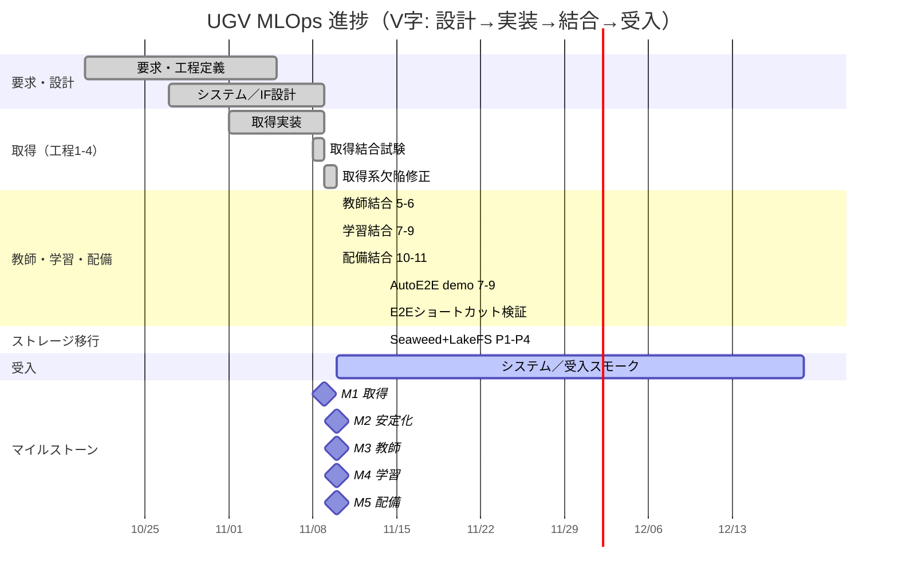

# 進捗管理ガント（UGV オンプレ MLOps）

**正本データ:** [progress.yaml](progress.yaml)  
**工程定義:** [pipeline-stages.md](pipeline-stages.md) · **設計:** [design.md](design.md)

最終同期: **2026-11-14**（知覚 1–11 + Seaweed/LakeFS P4 + AutoE2E/古典E2E + **CARLA live smoke** + O7。次は受入仕上げ）

---

## 運用ルール

1. 状態を変えるときは **先に `progress.yaml` を更新**する（`status` / `progress` / `evidence` / `updated`）。
2. 続けて本ファイルの **工程表・マイルストーン・Mermaid** を同じ内容に揃える。
3. `status` は `planned` | `in_progress` | `blocked` | `done` | `deferred` のみ。
4. 結合試験が通ったら該当工程の `verified`（ISO 日付）とマイルストーン `evidence` を必ず書く。
5. コミットメッセージ例: `progress: M5 package/sync 完了`。

---

## いまの位置（V字）

| V字層 | 状態 |
|-------|------|
| 要求・設計 | done |
| 知覚スモーク結合（工程1–11） | **done** |
| E2E/AutoE2E ショートカット | **done** |
| SeaweedFS + LakeFS 移行（P1–P4） | **done** |
| 受入（ポータル整合・恒久イメージ） | in_progress |

---

## マイルストーン

| ID | 目標 | 期日 | 状態 | 根拠 |
|----|------|------|------|------|
| M1 | 取得系（1–4） | 2026-11-09 | done | Town07 → import → ingest → data-qa |
| M2 | 取得系安定化 | 2026-11-10 | done | LS / DVC / bag名 import |
| M3 | 教師系（5–6） | 2026-11-10 | done | annotate → label-review |
| M4 | 学習系（7–9） | 2026-11-10 | done | v3 → train S3 → gate smoke → `mdl_70c9d2d1556e` |
| M5 | 配備（10–11） | 2026-11-10 | done | onnx `mdl_26a1a3f71aa6` → `pkg_583f6b9e…` → UGV-01 inbox |

---

## 11 工程ボード

| # | id | 状態 | 検証日 |
|---|-----|------|--------|
| 1–4 | 取得 | done | 2026-11-09 |
| 5–6 | 教師 | done | 2026-11-10 |
| 7–9 | 学習 | done | 2026-11-10 |
| 10 | lighten | done | 2026-11-10 |
| 11 | package_sync | done | 2026-11-10 |

---

## オープンアイテム

| ID | 内容 | 優先度 | 状態 | 期日 |
|----|------|--------|------|------|
| O4 | cmd_vel / CostNav で E2E 経路 | P1 | **done** | 2026-11-14 |
| O7 | train `stage=smoke` を拒否 | P2 | **done** | 2026-11-14 |
| O8 | worker に skl2onnx/onnx を同梱再ビルド | P1 | **done** | 2026-11-14 |
| O9 | Seaweed + LakeFS P1–P3 | P0 | **done** | 2026-11-14 |
| O10 | P4 fail-closed + DVC/Garage 掃除 | P1 | **done** | 2026-11-14 |
| O11 | CLI/API 揃え + 短 ingest→train | P0 | **done** | 2026-11-14 |
| O12 | AutoE2E 合成デモ train→gate | P0 | **done** | 2026-11-14 |
| O13 | CARLA ライブ→import→ingest→qa | P1 | **done** | 2026-11-14 |

---

## ガントチャート

---

## 変更履歴（要約）

| 日付 | 内容 |
|------|------|
| 2026-11-09 | ガント正本を新設。M1 完了 |
| 2026-11-10 | M2–M5 完了（工程1–11 知覚スモーク）。層化分割・LS Cookie・DVC・ONNX unwrap 修正 |
| 2026-11-14 | SeaweedFS all-in-one + LakeFS 中核（P1–P3 スモーク）。O9 done / O10=P4 残 |
| 2026-11-14 | CLI/API を LakeFS に揃え。短 ingest→dataset→train（`ds-seaweed-smoke-v1` / run `2df0c36e…`）O11 done |
| 2026-11-14 | P4 完了: `LAKEFS_REQUIRED=true`、DVC/Garage 残骸削除、portal 表記更新（O10） |
| 2026-11-14 | O8 worker 再ビルド（skl2onnx）。lighten onnx→package→sync OK。AutoE2E readiness 修正 |
| 2026-11-14 | O12 AutoE2E: `ds-autoe2e-demo-v2` → run `30124649754b…` ADE 0.433 → gate staging `mdl_30124649754b` |
| 2026-11-14 | O4 古典 E2E: `demo-e2e` → `ds-e2e-demo-v4` → `mdl_68bc49fc2f3e`。O7 `assert_learning_stage` |
| 2026-11-14 | O13 CARLA live: offscreen → `smoke_20261114_143755` → `M-CARLA-LIVE-20261114` ingest+qa passed |
