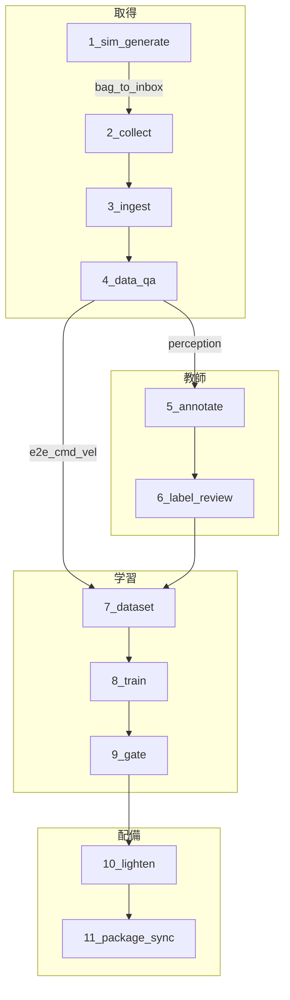
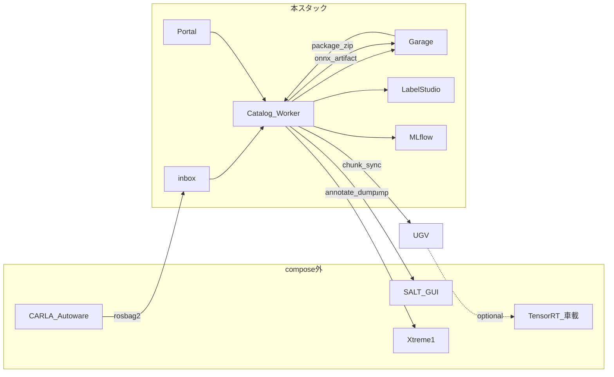

# パイプライン工程（11）とツール連動

ポータルの工程カードと Catalog の契約を固定する。起動・日常操作は [usage.md](usage.md)、**学習タスク一覧**は [tasks.md](tasks.md)、四脚との層対応は [workflow.md](workflow.md)、内部配線は [design.md](design.md)。

旧 8 工程（置く → 取込 → ラベル → 版切り → 学習 → ゲート → 梱包 → 同期）に、**シミュ生成・取込確認・ラベル確認・軽量化** を足した。

---

## フェーズ

| フェーズ | 工程 | 目的 |
|----------|------|------|
| 取得 | 1–4 | シミュ／帰還データを inbox → Catalog へ入れ、中身を確認する |
| 教師 | 5–6 | 知覚ラベルを付け、Xtreme1 で突き合わせる（E2E はスキップ可） |
| 学習 | 7–9 | 版切り → 学習 → 指標ゲート |
| 配備 | 10–11 | 軽量化 → 梱包・UGV 同期 |



---

## 工程一覧

| # | id | タイトル | 主ツール | Catalog 契約 | 実処理 |
|---|-----|----------|----------|--------------|--------|
| 1 | `sim_generate` | シミュでデータを作る | Autoware_e2e / CARLA（compose 外） | `POST /pipeline/sim-generate` | 任意で inbox の bag 実在検証＋監査 |
| 2 | `collect` | 帰還／シミュ結果を置く | `data/inbox` | ホスト FS | オペレータがコピー（API 書込なし） |
| 3 | `ingest` | カタログへ取り込む | Catalog / Worker / Garage / DVC | `POST /ingest` | パース・Garage・DVC |
| 4 | `data_qa` | 取込データを確認する | データタブ + preview | `POST /data-qa` | カメラ/action/件数検査。不合格はジョブ失敗 |
| 5 | `annotate` | ラベルを付ける | Label Studio / SALT / SAM | `POST /annotate/init` | dump＋LS 投入（失敗はジョブ失敗）。E2E スキップ可 |
| 6 | `label_review` | ラベル・センサを突き合わせ確認 | Xtreme1 `:8190` | `POST /label-review` | ラベル or cmd_vel 必須。監査 |
| 7 | `dataset` | 学習用データセットを切る | Garage `datasets` | `POST /datasets/build` | 版切り（`mission_id` で絞り可） |
| 8 | `train` | 学習する | MLflow + Worker | `POST /train` | 実学習 |
| 9 | `gate` | 指標で通す | ゲート + 署名 | `POST /gate` | 指標＋**実サイズ**＋署名 |
| 10 | `lighten` | モデルを軽量化する | Worker | `POST /models/export` | ONNX/adapter。失敗は偽成功しない。S1 は adapter 等 |
| 11 | `package_sync` | 梱包して UGV へ同期 | Garage + chunk | `/packages` → `/sync` → `/chunk` | zip 作成後、`data/work/vehicles/<車両>/inbox/` へ実書き込み |

---

## スキップ規則

| 条件 | スキップしてよい工程 |
|------|----------------------|
| 実機帰還のみ（シミュなし） | 1 |
| `task=e2e`（cmd_vel が教師） | 5, 6 |
| 成果物が既に `onnx` / `adapter` で対象段のサイズ制限内 | 10 |
| 公開デモ（smoke） | 1 と、必要なら 10。ゲートは `smoke` |

知覚（`obstacle_cls` / `detection`）で 5–6 を飛ばすと版切りが失敗するか、未ラベルのまま学習品質が落ちる。

---

## ツール連動



| 区間 | 連動 | 備考 |
|------|------|------|
| CARLA → inbox | `GET /carla/bags` → `POST /carla/import` で inbox へコピー | 詳細は [carla.md](carla.md)。compose に CARLA を載せない |
| ingest → data_qa | preview 検査。不合格はジョブ失敗 | 知覚はカメラ必須。E2E は action/cmd_vel |
| annotate → label_review | Xtreme1 は確認専用工程 | Freespace マスクには使わない |
| gate → lighten | 合格モデルから ONNX/adapter を別 `model_version` に登録 | 段ホワイトリストは `artifact_policy.yaml`。S1+onnx は拒否 |
| lighten → package_sync | 梱包は許可 kind のみ。同期は車両 inbox へ実ファイル | 配送先: `data/work/vehicles/<車両>/inbox/*.zip`。TensorRT は車載側 |

---

## シミュ（工程1）の手順概要

詳細は [carla.md](carla.md)。

1. Autoware_e2e で CARLA + `mining_sim.py` を起動し、rosbag2 を録る（`OFFROAD_CARLA_HYBRID.md`）。出力例: `datasets/carla_bags/<run>/`。
2. ポータル工程1で bag を選び「CARLA bag を inbox へ取り込む」（`POST /carla/import`）。または手動で `data/inbox/<mission>/` にコピー。
3. 「inbox の bag を確認した」で監査。実機のみなら工程1スキップして工程2へ。
4. 工程3 ingest 以降は実機帰還と同じ取込線。

E2E なら bag に `/cmd_vel`（または同等の操作トピック）を含める。知覚なら工程5で人手ラベルが必要。

---

## 同期の置き場（工程11）

Catalog は Garage の package zip を読み、チャンクごとにホスト側の車両 inbox へ書き込む（実車リンクの代わりのオンプレ配送バッファ）。

```
data/work/vehicles/<vehicle_id>/inbox/<package_id>.zip
```

完了時に sha256 を検証する。失敗時は `rolled_back`。

---

## やらないこと

- CARLA / Genesis / TensorRT を本 `docker-compose.yml` に追加しない
- ゲート前の未署名フル重みを軽量化成果物として本番同期しない
- ONNX 変換失敗を「成功した軽い成果物」として登録しない
- 「確認」を Grafana 監視に置き換えない
