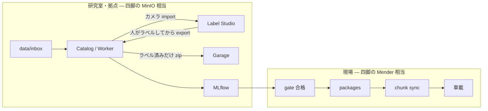

# 自動運転向け MLOps ワークフロー

四脚 PJ（Go2 Pick-and-Carry / `PAI_Task`）で整えた層を、こちらのツールに写した一連の流れです。フォルダ契約は [dataset.md](dataset.md)、起動は [usage.md](usage.md)、ツール内部の配線は [design.md](design.md)。

四脚は **シミュ学習 → 最良重みを倉庫へ → 実機 OTA**（観測・行動・報酬はシミュが毎回出す。人手ラベルは無い）。自動運転は **帰還 bag → 人手アノテーション → データセット → 学習 → ゲート通過分だけ車載へ**。ingest しただけでは教師にならない。

---

## 層の対応（四脚 → こちら）

| 層 | 四脚 PJ | 自動運転（本リポジトリ） | 役割 |
|----|---------|--------------------------|------|
| コード | GitHub | この Git。任意で Gitea `:3000` | 学習コード・ポリシー。ホットパスに載せない |
| 実験ノート | MLflow（`logs/mlflow`） | MLflow `:5000`。成果物は Garage `mlflow` | パラメータ・指標。**学習のたびに書く** |
| 大きい成果物の版 | DVC ポインタ + MinIO `pai-dvc` | **DVC ポインタ + Garage `s3://dvc`**。学習が参照する ID は Catalog `dataset_version` | Git に zip/重みを置かない。ingest / 版切りの区切りでだけ `dvc push` |
| 研究用倉庫 | MinIO | Garage（S3）`raw` / `datasets` / `models` / `mlflow` / `dvc` | PC 間・再開用の実体 |
| 現場への配達 | Mender（`best.pt` → `.mender`） | `POST /gate` → `/packages` → `/sync` | 合格したものだけ。失敗時ロールバック |
| **アノテーション** | なし（シミュが教師を出す） | **必須。** Label Studio クラス/bbox、SAM Freespace、SALT 点群、Xtreme1 確認 | 詳細は [annotation.md](annotation.md) |
| 人が見る入口 | 起動メニュー 9 | ポータル http://127.0.0.1:8080 | 状態確認とジョブ投入。ID/パスワードは [usage.md](usage.md#画面の場所と初期-id--パスワード) |

四脚の `dvc_sync publish --select best` に相当するのが **ゲート**。metrics のピーク近い重みを人手で抜く代わりに、Catalog が閾値を見て `model_version` を切る。

四脚に無い段が **アノテーション** である。知覚分類・検出はラベル無しでは `datasets/build` が失敗する（`JOIN annotation`。未ラベルは zip に入らない）。

---

## 一本線

学習ホットパスでは倉庫へ毎ファイルを push しない（四脚が毎 iteration `dvc push` しないのと同じ）。

```text
帰還 / 物理媒体
    → data/inbox/<mission>/     ROS2 bag・画像・series/*.jsonl
              │
              ├─ POST /ingest          毎回ミッションごと（まだ教師なし）
              │     Garage raw + Postgres learning_sample
              │     カメラ URL を Label Studio へ import
              │
              ├─ ★ 人手アノテーション   知覚の必須。ここで初めて教師が付く
              │     画像クラス/bbox = Label Studio :8081
              │     Freespace = SAM（Autoware tools/annotate.py）→ import-masks
              │     LiDAR = SALT GUI → import-jsonl
              │     確認 = Xtreme1 :8190（箱検出。マスクには使わない）
              │     未ラベルのまま datasets/build しない
              │     取込→追跡→パース→保管（DVC GUI と同じ）。parsed は cameras / lidar.bin / localization
              │     DVC が Garage s3://dvc へ（失敗しても ingest は成功）
              │
              ├─ POST /datasets/build  区切り（ラベル済みだけ版を切る）
              │     Garage datasets + dataset_version_id
              │
              ├─ POST /train           実験のたび
              │     ├─ MLflow metrics（毎回）
              │     └─ Garage models（成果物）
              │
              └─ POST /gate            区切り（車載に出してよいか）
                    └─ 合格だけ package → sync → UGV
```

中核（既定の `docker compose up -d`）は **inbox → ingest → アノテーション → データセット → train / MLflow** まで。梱包と同期は四脚の Mender 段。LakeFS / Gitea / Grafana は `--profile full`。



---

## 日常の順

四脚メニュー 9 の「起動 → publish → 推論確認 → OTA」に対応する。

### 1. スタックを上げる

デスクトップの `起動スクリプト\MLOPS\MLOPS起動.bat` で **1**。または:

```powershell
cd C:\Users\xeno1\MLOPS
.\launcher\MLOPS_run.bat
docker compose up -d
```

入口は http://localhost:8080。MLflow は http://localhost:5000、Label Studio は http://localhost:8081。

### 2. ミッションを置く（四脚の `logs/` に相当する生データ側）

`data/inbox/<mission_id>/` に ROS2 bag（`metadata.yaml` + `.db3` / `.mcap`）または展開済み画像 + `series/*.jsonl`。契約は [dataset.md](dataset.md)。

### 3. 取り込む

```powershell
Invoke-RestMethod -Method POST http://localhost:8000/ingest `
  -ContentType application/json `
  -Body '{"path":"/data/inbox/M-20260831-001","source_type":"physical_media"}'
```

Worker が bag をパースする。カメラ JPEG、IMU/GNSS/LiDAR/cmd_vel の jsonl、元 bag が Garage `raw` へ入る。

### 4. アノテーションする（知覚では必須。飛ばさない）

ingest 完了は「ファイルがカタログに載った」だけである。四脚のシミュと違い、クラスも bbox も bag からは出ない。

| タスク | 人手アノテーション | 無いとどうなるか |
|--------|--------------------|------------------|
| `obstacle_cls` | **必須**。`clear` / `obstacle` / `person` | `datasets/build` が `no labeled unclassified samples` で失敗 |
| `detection` | **必須**。bbox（COCO 形式可） | bbox の `JOIN` が空。学習セットができない |
| `e2e` | 画像クラスは不要。`cmd_vel` が教師 | 操作系列が無い／時刻が揃わないと失敗。知覚モデルの代用にはならない |

手順の本体は [annotation.md](annotation.md)。ポータルの「ラベル済み」件数が 0 のまま 5 へ進まない。

### 5. データセット版を切る（四脚の `dvc_sync publish`）

```powershell
Invoke-RestMethod -Method POST http://localhost:8000/datasets/build `
  -ContentType application/json `
  -Body '{"task":"obstacle_cls"}'
```

`task` は `obstacle_cls` / `detection` / `e2e`。知覚は **アノテーション済みかつ非機密（または解除済み）だけ** zip に入る。学習が参照する正は **Catalog の `dataset_version_id`**（LakeFS は任意）。

### 6. 学習する（四脚の PPO 実行 + MLflow）

```powershell
Invoke-RestMethod -Method POST http://localhost:8000/train `
  -ContentType application/json `
  -Body '{"dataset_version_id":"<id>"}'
```

指標は MLflow。重みは Garage `models`。`training_run.run_id` は MLflow の run_id と同じ。

### 7. ゲート（四脚の `--select best`）

```powershell
Invoke-RestMethod -Method POST http://localhost:8000/gate `
  -ContentType application/json `
  -Body '{"run_id":"<mlflow_run_id>","gate_name":"staging"}'
```

通ったものだけ署名付き `model_version`。MLflow UI は人が見る用で、合格判定は Catalog の `metrics_json`。

### 8. 車載へ（四脚の Mender Artifact）

```powershell
Invoke-RestMethod -Method POST http://localhost:8000/packages `
  -ContentType application/json `
  -Body '{"model_id":"<id>"}'
Invoke-RestMethod -Method POST http://localhost:8000/sync `
  -ContentType application/json `
  -Body '{"package_id":"<id>","vehicle_id":"UGV-01"}'
```

Garage `packages` が倉庫、`/sync` のチャンクが配達。失敗時はロールバック。OS イメージ更新とは分け、モデル zip だけを送る（四脚が rootfs と `pai-model` を分けたのと同じ）。

一気通貫の煙試験は `POST /demo` / `/demo-e2e` / `/demo-yolox` / `/demo-rosbag`。

---

## タスクと教師

| タスク | 四脚で言うと | 教師 | 人手アノテ | ゲートの目安 |
|--------|--------------|------|------------|----------------|
| `obstacle_cls` | 無い（シミュはクラスを出さない） | Label Studio / labels.jsonl | **必須** | accuracy, FPR |
| `detection` | 無い | COCO bbox | **必須** | map50 |
| `e2e` | BC / ValueDICE に近い | 同時刻の cmd_vel | 不要（操作ログが教師） | mae_steer, mae_speed |

自動運転の主経路は上 2 つである。`e2e` は四脚の模倣学習に近く、**知覚のラベル作業を省略してよい理由にはならない**。歩行 RL を載せるなら四脚側と同じく学習は別プロセス、MLflow Tracking URI だけこの `:5000` を指す。

---

## 置き場

| 何 | 四脚 | 自動運転 |
|----|------|----------|
| 生データ | Genesis が毎 step 生成 | `data/inbox` → Garage `raw` |
| 教師 | シミュの報酬・CPG 教師 | **人が付けた `annotation`**（E2E だけ cmd_vel） |
| 実験 DB | `logs/mlflow/mlflow.db` | MLflow + Postgres `mlflow` |
| 抜粋した最良重み | `artifacts/checkpoints/<stage>/best.pt` | Garage `models` + `model_version` |
| 端末上の active | `/data/pai/models/active/best.pt` | 同期後の車載パッケージ（ゲート通過分） |

---

## やること / やらないこと

やること:

- ミッションごと ingest したあと、**知覚は必ずアノテーション**（Label Studio / SAM / SALT。確認は Xtreme1）。未ラベルでデータセットを切らない
- 学習のたびに MLflow へメトリクス
- **区切りでだけ** DVC push・dataset 版切り・ゲート・梱包（四脚の publish / Mender と同じ）
- 倉庫（Garage）と配達（sync）を分ける。車載から Garage を直接 wget しない

やらないこと:

- ingest 済みを「学習できる」とみなさない（教師が付くまで待つ）
- フレームごと・iteration ごとにデータセット zip やパッケージを切らない
- `raw` 全履歴を車載へ送らない
- ゲート前の重みを本番同期しない
- 四脚の MinIO / Mender をこの compose に足さない（倉庫は Garage、配達は sync。DVC リモートも Garage）
- Xtreme1 を Freespace マスク作業に使わない
- 火力統制とは混ぜない

---

## 四脚 PJ とサーバを共用する場合

同じホストの MLflow `:5000` と Garage `:9000` を四脚学習から使ってよい。**experiment 名と S3 プレフィックスを分ける**（例: `quadruped` / `ugv`、`s3://models/quad/`）。Catalog の ingest〜ゲートは UGV の bag 契約向けなので、四脚の PPO ログは Catalog ジョブに載せない。
